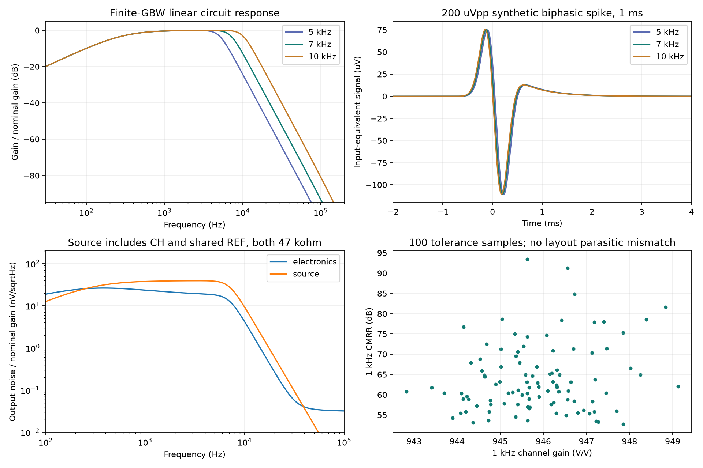

# Candidate AFE calculation record

**Architecture correction, 2026-09-22:** historical ADC-based study. D-012 in the [engineering handbook](../../engineering-handbook.md) removes waveform ADC acquisition. ADC sizing, MCU ranking based on ADC resources, and sampled software detection are superseded for the current design. Analog transfer/noise calculations remain candidate evidence, not validation of an analog comparator detector. System power/runtime must be recalculated for the revised architecture.

**2026-09-21 · Simulated/calculated, not measured.**

Source model and reproducible analysis: [afe_study.py](../../../tools/analysis/afe_study.py). Run with NumPy, SciPy and Matplotlib. Exact outputs: [results.json](results.json). Circuit connectivity and nominal values: [system proposal](../../design/2026-09-21-curalink-rev-a-proposal.md). Exported [linear netlist](../../../hardware/design/afe-channel-linear.cir) was generated but not executed in a SPICE simulator.

## Method and assumptions

- Modified nodal analysis of one complete channel plus its shared REF input stage.
- Op amps: open-loop gain 100,000, 10 MHz GBW, one dominant pole, zero output impedance. No supply clipping, slew limiting, saturation recovery, nonlinear input clamps, or manufacturer macro-model.
- Input capacitance: 7 pF effective shunt value per input, with additional 4/15/30 pF sensitivity checks. This is a modeling assumption, not a measured PCB value.
- Resistors at 300 K; independent Johnson noise sources. Both signal and reference electrode models have 47 kΩ source resistance.
- Amplifier noise: 10 nV/√Hz multiplied by sqrt(1+1560/f), approximating the datasheet's typical 1 kHz/high-frequency values; 23 fA/√Hz input current noise at each input. No guaranteed noise corners inferred.
- VMID and supplies ideal; unmodeled shared-reference/supply/EMI terms require separate allocation and measurement.
- Monte Carlo: 100 deterministic seeds, independent uniform tolerances; selected gain/matching resistors ±0.1%, remaining resistors/capacitors ±1%. No parasitic mismatch or temperature drift.

## Principal results

| Quantity | Result |
|---|---:|
| Nominal gain product | 988.59 V/V |
| Actual modeled gain at 1 kHz | 945.50 V/V |
| HP corner from nominal R/C | 296.93 Hz |
| LP pole frequency | 7042.25 Hz |
| Electronics noise, 300–7000 Hz, divided by nominal gain | 1.603 µV RMS |
| Electronics noise, same bandwidth, divided by 1 kHz gain | 1.676 µV RMS |
| Source noise including 47 kΩ REF, divided by 1 kHz gain | 3.189 µV RMS |
| ADC allocation, assumed 0.5 LSB RMS, divided by 1 kHz gain | 0.387 µV RMS |
| Combined source/electronics/ADC, 1 kHz convention | Approximately 3.623 µV RMS |
| 100-draw gain range at 1 kHz | 942.83–949.12 V/V |
| Minimum/median observed CMRR at 1 kHz | 52.76 / 61.82 dB |
| Input impedance at 7 kHz with 7 pF model | 3.216 MΩ |
| Loading loss at 7 kHz with 100 kΩ source | 0.499% |

Input-referred noise here is integrated output noise divided by the explicitly stated reference gain. It is not pointwise inversion of the full band-pass transfer function. The source-noise contribution is excluded from the electronics-only target. No claim is made that all interference is random or uncorrelated.

An independent ideal-cascade formula agrees with the modeled 1 kHz gain within the scripted 3% bound. Nominal matched CH/REF paths cancel common-mode transfer within the scripted numerical tolerance. These are consistency checks of the linear model, not physical verification.

## Bandwidth comparison

Input templates are derivatives of Gaussians; the named duration is six sigma. They are synthetic test signals, not a representative biological dataset. Retention is output pp divided by nominal gain and input pp.

| Template duration | 5 kHz LP | 7 kHz LP | 10 kHz LP |
|---|---:|---:|---:|
| 0.5 ms | 95.32% | 97.43% | 97.62% |
| 1 ms | 92.94% | 92.98% | 93.00% |
| 2 ms | 81.93% | 81.94% | 81.94% |

These results preserve 7 kHz as a reasonable candidate but do not demonstrate optimal detection performance across corners. Slow-waveform attenuation is dominated by the high-pass. Corner-specific detection/noise optimization using real templates remains open.

## Aliasing estimate

At 64 kS/s/channel, modeled analog attenuation is about 52.7 dB at Nyquist and 73 dB at 57 kHz. Summing ten spectral image pairs into 300–7000 Hz predicts an additional 0.0115 µV RMS electronics-noise alias contribution when referred using nominal gain. This assumes stationary modeled noise, ignores nonlinear rectification and ADC sampling dynamics, and does not establish immunity to strong out-of-band interferers.

## Illustrative detector trial

The separate detector demonstration uses a digital 297 Hz first-order HP plus 7.042 kHz fourth-order Butterworth filter at 64 kS/s. This approximates the analog band shape; it is not a time-domain run of the complete MNA circuit. Gaussian filtered noise is scaled to 3.5 µV RMS input-equivalent. The record is ten seconds, contains 99 isolated seeded events, and has no LFP, artifacts, overlapping units, clipping, or baseline drift.

A two-sided five-sigma threshold with a simple 1.5 ms refractory timer produced duplicate/unmatched detections on some large/wide templates. A revised candidate adds a two-millisecond minimum lockout and 250 µs continuously below two sigma before rearming.

| Input | Revised detector results across 0.5/1/2 ms templates |
|---|---|
| 20 µVpp | 8/99, 8/99 and 10/99 detected; no unmatched events in these trials |
| 50–500 µVpp | 99/99 detected in each tested condition; zero unmatched/duplicate events in these trials |

This is a limited synthetic sanity check, not a false-positive-rate guarantee or validated detection specification. It does not characterize close-pair resolution. The retained script and JSON record both the initial and revised results so the algorithm change has an auditable reason.
