# CuraLink Rev A — complete system design proposal

**Architecture correction, 2026-09-22:** historical ADC-based study. D-012 in the [engineering handbook](../engineering-handbook.md) removes waveform ADC acquisition. ADC sizing, MCU ranking based on ADC resources, and sampled software detection are superseded for the current design. Analog transfer/noise calculations remain candidate evidence, not validation of an analog comparator detector. System power/runtime must be recalculated for the revised architecture.

**Power correction, 2026-09-22:** D-007/D-016 now require mutually exclusive WPT CHARGE (main system off) and battery RUN. The BQ25185 load-sharing route and power circuitry below are historical candidates, not the current power-path selection.

**2026-09-21 · Revision P0 · Engineering proposal, not a fabrication release**

**Scope note:** the user subsequently narrowed this task to gain calculations and high-level parts selection. This document preserves the broader work already completed; its implementation plan is deferred. Start with the [concise gain and parts note](gain-and-parts-shortlist.md).

## 1. Recommended direction

Use an **EFR32BG22C224F512GM32-C BLE microcontroller**, a custom discrete eight-channel AFE with a separately conditioned shared reference, internal ADC acquisition at a candidate **64 kS/s per channel**, and a **50 mAh-class rechargeable cell**. Retain wireless charging, SWD/UART, calibrated waveform access, and the passive AWG fixture.

This is a coherent proposed implementation of every functional block. It includes resistor/capacitor values, a candidate pin assignment, acquisition and telemetry contracts, power and cost allocations, and executable circuit calculations. It is not a completed KiCad schematic/PCB, verified firmware, EM simulation, or manufactured board. Component procurement, circuit overload behavior, RF matching, and the WPT assembly remain release gates.

**User-confirmed constraints:** under US$150 for the first assembled prototype excluding lab equipment; initially one hour of battery operation; no hard completion deadline. Custom AFE design remains a central project objective. MCU vendor and internal versus external ADC are explicitly reopened. The earlier October 18 planning deadline is retired.

**Why this direction:** a small BLE-focused MCU can provide acquisition and telemetry without Wi-Fi or an external ADC. However, the AFE is the larger power and area contributor. Replacing the MCU alone will not produce an order-of-magnitude smaller device.

## 2. Architecture and functional blocks

```mermaid
flowchart LR
    J[18-pin input FFC] --> IN[8 input preamps: gain 11]
    J --> REF[Shared REF preamp: gain 11]
    IN --> HP[8 differential HP stages: 297 Hz / gain 34.89]
    REF --> HP
    HP --> LP1[8 low-pass biquads: Q 0.541 / gain 1.15]
    LP1 --> LP2[8 low-pass biquads: Q 1.316 / gain 2.24]
    LP2 --> RC[100 ohm / 470 pF ADC interfaces]
    RC --> ADC[BG22 ADC scan + LDMA]
    ADC --> DET[Threshold / rearm / refractory / bins]
    DET --> BLE[BLE + matching + antenna]
    BLE --> HOST[Python host / logs / captures]
    ADC --> UART[UART and SWD access]
    TX[External Qi transmitter] --> COIL[RX coil and resonant network]
    COIL --> RX[BQ51013B receiver: 5 V]
    RX --> CHG[BQ25185 power-path charger]
    BENCH[Isolated bench 5 V input] --> CHG
    BAT[Protected 1S battery] <--> CHG
    CHG --> LDOA[3.0 V analog LDO]
    CHG --> LDOD[3.0 V digital LDO]
    LDOA --> IN
    LDOA --> REF
    LDOA --> MID[Buffered 1.5 V midpoint]
    LDOD --> ADC
```



The Qi/wound-coil route is a **candidate implementation**, not an accepted replacement for the earlier PCB-coil direction. Section 10 preserves a custom-coil development route and explains the tradeoff. All functional outputs remain the same.

| Block | Proposed implementation | Interface / governing check |
|---|---|---|
| Input | 8 signals + REF, interleaved ground FFC | Defined return path; calibrated source and cable capacitance |
| First gain | 9 matched gain-11 noninverting stages | Tolerate input offsets before differential HP |
| Reference rejection | AC-coupled difference amplifier per channel | Match gain ratios and HP capacitors |
| Anti-alias filter | Two Sallen-Key biquads per channel | Approximately fourth-order Butterworth, 7.04 kHz pole frequency |
| ADC drive | 100 Ω series, 470 pF at pin | Check switched-capacitor settling and amplifier stability |
| Acquisition | BG22 scan, PRS timing, LDMA | No software-triggered conversion loop |
| Processing | Two-sided threshold, lockout, return-to-baseline | Prevent double counts; tag overload and dropped blocks |
| Wireless | BLE count notifications and configuration | Raw capture is buffered debug operation |
| Power | Separate 3.0 V LDO branches, 1.5 V analog midpoint | Voltage sequencing and common-reference noise |
| Charging | BQ25185 with 25 mA initial charge setting | Match the purchased cell's allowed current and temperature sensing |
| WPT | Candidate Qi RX, compatible coil, external TX | Coupling/startup/FOD/tuning must be demonstrated |
| Debug | SWD, reset, UART, rail injection, stage test pads | Accessible without BLE or wireless power |

## 3. MCU and ADC trade study

Chip dimensions exclude crystals, matching, antenna keep-out, decoupling, programming pads, and any external converter. Raw package area is not system area.

| Candidate | Relevant facts | Evaluation for CuraLink |
|---|---|---|
| **EFR32BG22C224F512GM32-C** | 4 × 4 mm QFN; BLE; 76.8 MHz Cortex-M33; 512 KB flash, 32 KB RAM; 12-bit 1 MS/s IADC and LDMA | Leading candidate: eight available analog GPIOs plus wired debug and control fit the proposed map. RAM forces small buffers. [Datasheet](https://www.silabs.com/documents/public/data-sheets/efr32bg22-datasheet.pdf) |
| ESP32-C3 | 5 × 5 mm bare chip; Wi-Fi/BLE; six ADC inputs across its ADC units | Does not directly provide eight channels. Adding a mux or external ADC changes size, power, and firmware risk. Wi-Fi throughput is unnecessary for count telemetry. [Datasheet](https://documentation.espressif.com/ESP32-C3_Datasheet_en.pdf) |
| CC2340R5 family | 4 × 4 and 5 × 5 mm QFN options; 12-bit ADC, up to 1.2 MS/s with external reference | Strong alternative, but family headline input counts do not prove the 24-pin package can meet the full pin budget. Evaluate larger package if needed. [Datasheet](https://www.ti.com/lit/ds/symlink/cc2340r5.pdf) |
| nRF52832 | BLE and mature tooling; 200 kS/s ADC aggregate | Eight channels permit at most 25 kS/s each at headline maximum, before timing margin. Requires stronger filtering or external acquisition for the proposed 64 kS/s path. [ADC specification](https://docs.nordicsemi.com/r/bundle/ps_nrf52832/page/saadc.html) |
| nRF54L15 | 250 kS/s at 12 bits; faster lower-resolution modes; 6 × 6 mm QFN option | Viable, but 12-bit aggregate sampling and package do not improve this particular proposal. [Specifications](https://docs.nordicsemi.com/r/bundle/ps_nrf54l15/page/keyfeatures_html5.html) |
| STM32WBA | Existing family direction, exact part never selected | Remains fallback if firmware tools or BG22 resources prove unsuitable; no claim that every STM32 is larger or less efficient |
| BLE MCU + ADS7951 | Independent 8-channel, 12-bit, 1 MS/s SPI ADC | Valid custom-AFE architecture; adds converter/reference/drive/routing cost and area. Reserve as fallback rather than populate speculatively. [ADC](https://www.ti.com/product/ADS7951) |

**Decision logic:** select sufficient analog acquisition, debug access, and BLE in the smallest practical complete subsystem. Do not select an ESP solely because a reference project uses one. An MCU without an ADC would still justify the custom AFE; it would simply require a separate converter or a deliberately reconsidered event-detector architecture.

## 4. Custom AFE circuit

Use **nine TLV9064SIRTER quad amplifiers** as the compact candidate: 36 amplifier elements, 34 used and two terminated spares. The shutdown variant supports charge-only operation. Use the 3 × 3 mm WQFN option rather than the smaller 2 × 2 mm X2QFN. Procurement availability is not established; the non-shutdown TLV9064IRTER or TSSOP variants are comparison options with explicit shutdown/area consequences.

TI lists typical 538 µA/channel, 10 MHz GBW, voltage-noise densities of 16 nV/√Hz at 1 kHz and 10 nV/√Hz at 10 kHz, and current noise of 23 fA/√Hz. These are typical values, not guaranteed 3 V noise bounds. [TLV906x datasheet, revision N](https://www.ti.com/lit/ds/symlink/tlv9064.pdf)

### Stage A — nine input preamplifiers

Apply the same network to CH1–CH8 and REF:

```text
electrode → 1 kΩ protection/current-limit resistor → 10 nF C0G → op-amp + input
                                                           │
                                                         22 MΩ
                                                           │
                                                         VMID

op-amp − input → 1 kΩ → VMID
op-amp output → 10 kΩ → op-amp − input
```

Supply is 3.0 V; VMID is approximately 1.5 V. The nominal gain is `1 + 10k/1k = 11`. The input coupling pole is approximately 0.72 Hz, before source/parasitic corrections. This is a DC-blocking interface; it is not the 300 Hz spike-band high-pass.

Why only gain 11 here: an abrupt ±100 mV electrode step initially causes approximately ±1.1 V output excursion, fitting a proposed 0.2–2.8 V working window around 1.5 V. A gain of 100 would not. Later stages can still clip on that step; startup/artifact blanking and recovery validation are required.

Use matched 0.1% gain resistors; 1% C0G coupling capacitors. Do not add a high-capacitance TVS across the sensitive input without revisiting the impedance/noise budget. The 1 kΩ resistor and internal clamps are only a proposed benign bench-input protection arrangement, not an established external-ESD rating. Protection leakage, board cleanliness, cable capacitance, and bias-current temperature behavior need testing.

### Stage B — AC-coupled differential high-pass and gain

For each channel:

```text
CH_PRE → 10 nF → 53.6 kΩ → op-amp − input
output → 1.87 MΩ → op-amp − input

REF_PRE → 10 nF → 53.6 kΩ → op-amp + input
op-amp + input → 1.87 MΩ → VMID
```

With matched networks and ideal amplifiers, voltages relative to VMID obey:

`V_B = [Rf/R × sRC/(1+sRC)] × (V_REF_PRE − V_CH_PRE)`.

Thus `G_B = 34.888`, `f_HP = 296.93 Hz`. The polarity is inverted with respect to CH−REF; document that in host calibration. Both polarities remain detectable. The unequal-looking positive and negative feedback paths produce matching differential transfer functions when all four resistors and the two capacitors satisfy the stated ratios.

Place paired components together. Use 0.1% resistors and 1% C0G capacitors; a tighter matched-capacitor pair is useful if common-mode tests demand it. This is not an instrumentation amplifier with guaranteed high CMRR. The shared REF preamp's noise appears in every channel and is correlated across them.

### Stages C and D — approximately fourth-order low-pass

Each stage is the standard noninverting Sallen-Key low-pass:

```text
previous output → R1 → node A → R2 → op-amp + input
node A → C1 → this stage's OUTPUT
op-amp + input → C2 → VMID
op-amp − input → Rg → VMID
this stage's output → Rf → op-amp − input
```

For both stages, `R1 = R2 = 22.6 kΩ`, `C1 = C2 = 1 nF C0G`, and `Rg = 10 kΩ`. Stage C uses `Rf = 1.50 kΩ`; stage D uses `Rf = 12.4 kΩ`.

For equal R/C values, `f0 = 1/(2πRC) = 7042 Hz`, `K = 1+Rf/Rg`, and `Q = 1/(3−K)`. This yields `(K,Q) = (1.15,0.5405)` followed by `(2.24,1.3158)`, close to the fourth-order Butterworth pole pair. Low-Q first reduces intermediate peaking. This is an approximation using standard values, not an exact Butterworth polynomial.

The two C1 capacitors connect to their respective amplifier outputs, **not VMID**. That connection is essential to the filter topology.

### ADC interface and analog gain

Final amplifier output → 100 Ω → ADC pin; 470 pF from ADC pin to analog ground. The extra pole is approximately 3.39 MHz, so it is for sampling-charge isolation rather than the principal anti-alias filter. Verify capacitive-load stability using a vendor model and measurement.

`G_nominal = 11 × 34.888 × 1.15 × 2.24 = 988.59 V/V`, approximately 59.90 dB. The linear model predicts **945.5 V/V at 1 kHz**, including the high-pass attenuation and finite amplifier gain. Use measured per-channel gain in data conversion.

| Electrode input | Stage A pp | Stage B pp, asymptotic | Final pp, nominal scaling | Ideal ADC codes pp at 3 V/12 bits |
|---|---:|---:|---:|---:|
| 20 µVpp | 0.220 mV | 7.675 mV | 19.77 mV | 27 |
| 50 µVpp | 0.550 mV | 19.19 mV | 49.43 mV | 67 |
| 200 µVpp | 2.20 mV | 76.75 mV | 197.7 mV | 270 |
| 500 µVpp | 5.50 mV | 191.9 mV | 494.3 mV | 675 |
| 1 mVpp | 11.0 mV | 383.8 mV | 988.6 mV | 1350 |

These are linear amplitude scales, not guaranteed waveform peaks or ADC ENOB. Actual spike shape and filter response affect the measured swing. Large LFP and artifacts can exhaust headroom despite small APs.

### Input-impedance exception requiring review

The original target of ≥10 MΩ throughout 300 Hz–7 kHz is **not met by this candidate**. Just 4 pF has 5.68 MΩ reactance at 7 kHz; adding a 22 MΩ bias resistor and parasitics lowers the magnitude further.

The model assumes 7 pF effective shunt capacitance, giving approximately **3.22 MΩ at 7 kHz**, but only **0.50% amplitude loss with a 100 kΩ source** at that frequency. With 15 pF, predicted loss is 0.67%; at 30 pF it exceeds 1%.

Propose an engineering requirement based on the actual objective: **≤1% source-loading amplitude error across the useful band for 20–100 kΩ source resistance, with phase error measured and reported**. Keep ≥10 MΩ as the unfulfilled original objective until the user accepts a revision. If retaining 10 MΩ is mandatory, redesign the interface with a lower-capacitance input stage or bootstrapping and re-evaluate stability, noise, and cost.

## 5. Calculations and simulations completed

Reproduce with `python tools/analysis/afe_study.py` using NumPy, SciPy, and Matplotlib. [Results and assumptions](../calculations/afe-study/report.md), [machine-readable results](../calculations/afe-study/results.json), and [linear netlist](../../hardware/design/afe-channel-linear.cir) accompany this proposal.

The model solves the resistor/capacitor circuit by modified nodal analysis with finite, dominant-pole op amps. It includes individual resistor Johnson noise, amplifier voltage/current noise, two electrode resistances, and input capacitance. It is not a vendor transistor-level or overload model.

| Result | Predicted value / interpretation |
|---|---|
| Electronics noise, 300 Hz–7 kHz | 1.68 µV RMS, output noise divided by 1 kHz gain |
| Two 47 kΩ source resistors | 3.19 µV RMS on the same convention; includes shared REF |
| ADC allocation | 0.5 LSB RMS assumed, not measured; approximately 0.39 µV input-equivalent at 1 kHz gain |
| Combined electronics + source + ADC | Approximately 3.62 µV RMS on the 1 kHz-gain convention |
| Attenuation at 32 kHz | Approximately 52.7 dB relative to nominal gain |
| Attenuation at 57 kHz | Approximately 73.0 dB; first 64 kS/s image entering the 0–7 kHz region |
| Nominal 1 ms synthetic spike retention | Approximately 93% pp after normalization by nominal gain |
| Tolerance study | 100 draws; 1 kHz gain 942.8–949.1 V/V; minimum observed 1 kHz CMRR 52.8 dB |

Monte Carlo results are sample observations, not worst-case guarantees. The noise model excludes VMID imperfections, supply coupling, resistor excess noise, dielectric effects, EMI, leakage and PCB contamination, ADC reference noise, and biological background. Retain a separate **3 µV RMS input-equivalent allowance** for unmodeled analog/reference/interference terms; quadrature combination with the modeled electronics and ADC remains below 6 µV, but the allowance has not been demonstrated.

The 5/7/10 kHz comparison uses derivative-of-Gaussian synthetic templates with stated widths. It supports 7 kHz as a working compromise, not a biological optimum. A 2 ms template loses about 18% pp even at 10 kHz: the 300 Hz high-pass, not only the low-pass, matters. Add real waveform templates before freezing corners.

## 6. ADC and MCU connection proposal

Use the ADC's external reference input tied to **A3V0**, analog gain 1, and a 0–3 V nominal single-ended range. ADC AVDD also uses A3V0; IOVDD uses D3V0. Check supply dependency/sequence limits on the exact device. At 12 bits, `LSB = 732.4 µV`; at 1 kHz that is about `0.775 µV/input code`.

At **64 kS/s/channel**, aggregate rate is 512 kS/s. A 64 kHz timer event requests one eight-entry scan. At the 1 MS/s conversion setting, the headline conversion time is 8 µs per scan, leaving about 7.6 µs in the 15.625 µs frame for any scan overhead. This is a feasibility calculation, not a measured timing guarantee. Check actual scan overhead and settling on a development board. All eight channels are sequential; nominal first-to-last skew is approximately 7 µs at 1 µs conversions.

The internal ADC uses a sampling capacitor (typical 1.8 pF at gain 1). Full-range mux steps, output-source impedance, and the external RC must be evaluated together. The model does not simulate switched-capacitor acquisition. [BG22 IADC programming interface](https://docs.silabs.com/mcu/latest/efr32bg22/group-IADC)

### Candidate QFN32 pin assignment

Physical pin numbers are from datasheet Table 6.3; analog routing is supported by Section 6.5. This is a resource-checked proposal, not a completed schematic/footprint audit.

| Physical pin | Pad | Proposed connection |
|---:|---|---|
| 1–6 | PC00–PC05 | AFE CH1–CH6 ADC inputs respectively |
| 16 | PB00 | AFE CH7 ADC |
| 15 | PB01 | AFE CH8 ADC |
| 17 | PA00 / VREFP | A3V0 external ADC reference, local bypass |
| 18 | PA01 | SWCLK |
| 19 | PA02 | SWDIO |
| 20 | PA03 | UART TX |
| 21 | PA04 | UART RX |
| 22 | PA05 | Charger /CE; default high disables charging until configured |
| 23 | PA06 | Charger STAT1, pull-up to D3V0 |
| 14 | PB02 | Charger STAT2, pull-up to D3V0 |
| 32 | PD00 | Battery divider ADC input, sampled during an explicit acquisition gap |
| 31 | PD01 | AFE_ENABLE to both shutdown inputs of each quad |
| 7, 8 | HFXTAL_I/O | 38.4 MHz crystal, load network from manufacturer reference design |
| 9 | RESETn | Debug pad and reset network |
| 10, 13 | RFVDD, PAVDD | D3V0 with local RF bypass, subject to selected supply configuration |
| 11, exposed pad, 27 | RFVSS, ground pad, VREGVSS | Continuous ground plane |
| 12 | RF2G4_IO | RF match → selectable antenna/test path |
| 24 | DECOUPLE | Required local capacitor only; not a supply for external loads |
| 25, 26, 28 | VREGSW, VREGVDD, DVDD | Copy the exact manufacturer direct-supply topology initially; DCDC population option after verification |
| 29 | AVDD | A3V0 |
| 30 | IOVDD | D3V0 |

PD00/PD01 are unavailable for an external 32.768 kHz crystal in this map. Use a supported calibrated internal low-frequency clock configuration and budget its actual BLE sleep/clock behavior. If that proves unacceptable, move to QFN40 or reduce a noncritical status GPIO; do not quietly repurpose SWD or an acquisition input.

Allocate the analog bus for both even/odd PC and PB pins. Disable GPIO digital inputs/pulls on analog pads. Verify the compiler/SDK can express all scan entries and PRS/LDMA routing before releasing the board. Preserve channel tags in DMA results while bringing up.

## 7. Firmware and host interfaces

### Acquisition and memory

Candidate ping-pong buffers: **2 × 64 frames × 8 channels × 4-byte tagged results = 4096 bytes**. Each buffer spans 1 ms at 64 kframes/s. Process one buffer while LDMA fills the other. ISR work is buffer handoff, timestamp/status, and overrun detection; detection runs outside the ISR. Never block acquisition on BLE.

At 76.8 MHz, 512 kSamples/s leaves approximately 150 CPU cycles per sample if the CPU did nothing else. Budget and measure detection, buffer management, and BLE activity rather than assuming that entire allowance is free. Prefer simple fixed-point operations; streaming variance/noise estimates update slowly and ignore flagged artifacts. Keep an explicit linker-map RAM budget because the chip has only 32 KB RAM shared with the stack.

### Detector state machine

Each channel subtracts a calibrated/slowly tracked baseline. A candidate event occurs when `abs(sample − baseline) > threshold_i`. Initial threshold = `5 × measured sigma_i`, configurable by host. After acceptance:

1. Enter lockout for at least **2 ms**.
2. Require **250 µs continuously below 2 × sigma_i** before rearming.
3. Count only after both conditions are satisfied.

These are proposed defaults, not locked physiological requirements. The circuit's negative sign does not affect two-sided detection. Saturation, supply changes, and AFE startup set an invalid-data flag and suppress counts until baseline recovery. Count the suppression duration, so missing observation time is visible.

The illustrative model initially double-counted large/wide waveforms using a simple 1.5 ms refractory timer. The additional baseline condition addresses that failure on the tested waveforms. It imposes dead time and can merge closely spaced spikes; characterize pairs and overlapping spikes before specifying maximum event rate.

### Normal count packet

Propose little-endian, **32-byte logical packet**:

| Field | Bytes |
|---|---:|
| Protocol version + flags | 1 + 1 |
| Sequence number | 2 |
| Bin-start timestamp, µs modulo 2^32 | 4 |
| Bin length, µs | 4 |
| Eight saturating unsigned 16-bit counts | 16 |
| Valid-channel mask + reserved | 1 + 1 |
| CRC-16 | 2 |

At 25 ms bins this is **10.24 kbit/s of application payload**. Define CRC-16/CCITT-FALSE: polynomial 0x1021, initial 0xFFFF, no reflection, xorout 0, covering the first 30 bytes; transmit CRC low byte first. BLE already checks link-layer integrity; the application CRC additionally covers recorded/forwarded frames and the UART route. Use half-open bins `[start,end)` and atomic handover. Report saturation and missed-bin flags.

Negotiate ATT MTU ≥35 for a single notification; provide explicit fragment index/count and sequence fields if operating at the default MTU. Start with a 25–50 ms connection interval and 0 dBm TX; measure current and latency before tuning. These settings are candidates.

### Raw debug capture and UART

Uncompressed acquisition is `8 × 64k × 2 = 1.024 MB/s`. Do not promise continuous eight-channel raw streaming over BLE or 115200-baud UART. Provide triggered finite captures and slower replay. An 8 KB packed buffer holds 512 frames, or 8 ms. Allocate it only if the final BLE/firmware RAM map permits; alternatively reuse acquisition buffers and pause counting with an explicit gap record.

Commands: `status`, `set_threshold`, `set_bin_us`, `set_detector`, `capture`, `get_calibration`, `set_mode`, `reset_stats`. Return versioned machine-readable replies. Host tools should log raw packets, decoded counts, configuration, firmware build identity, and capture validity flags. Live plots are secondary to reproducible logs.

## 8. BLE RF design

Use the manufacturer's BG22 matching topology as a starting point, not an arbitrary 50 Ω wire from the chip. Its nominal reference values are C1 1.2 pF, C2 1.3 pF, L1 2.6 nH, and C3 18 pF; reproduce the exact connection order from datasheet Figure 5.4. Actual layout and stack-up still require tuning. Keep 0402 footprints and a ground-via fence as appropriate.

Candidate antenna: **Johanson 2450AT18A0100001E**, nominal 3.2 × 1.6 mm. Reserve its specified ground clearance and matching footprints; the antenna body size is not its required board area. A 30 mm board with nearby battery/ferrite/coil is not the vendor evaluation ground plane. [Antenna drawing and layout guidance](https://www.johansontechnology.com/docs/3827/Antenna-2450AT18A0100001E-Rev4.0.pdf)

Provide a **mutually exclusive** zero-ohm selection between the onboard antenna path and a U.FL/test coax path. Do not leave the unused branch as a long RF stub. Start bring-up with a known antenna and then measure onboard S11 and packet performance in the final stack. Put the antenna at the board edge furthest from the input connector and avoid placing the coil/battery under its keep-out.

## 9. Rails, battery, and charge control

### Rail topology

`BQ25185 SYS → master switch → separate TPS7A2030 LDOs → A3V0 and D3V0`.

Use a package/orderable variant verified to provide 3.0 V; **TPS7A2030PDBVR** is the proposed SOT-23 option pending procurement audit. Each rail gets manufacturer-required ceramic input/output capacitance (start with 1 µF input and 4.7 µF output, verify effective capacitance). Add 100 nF at every IC supply and local bulk at radio and AFE groups. [Regulator family specifications](https://www.ti.com/product/TPS7A20)

The analog rail powers amplifier supplies, ADC AVDD, and its external reference. The digital rail powers MCU/radio per the selected supply topology. AFE_ENABLE disables the amplifiers during charging; do not switch off AVDD while the MCU remains powered without proving the device permits it. Connect all ground returns to a continuous plane with placement controlling current paths; do not cut the plane under ADC or RF routes.

VMID: 10 kΩ / 10 kΩ divider from A3V0, 10 µF at its midpoint, then one spare amplifier as a buffer. Use short local branches; avoid putting a large capacitor directly on the buffer output without stability isolation. Its noise and startup behavior are not covered by the ideal-VMID model. Allow at least one second startup blanking initially and release only after measured baseline stabilization.

### Battery and runtime calculation

Candidate cell: protected **1S 4.2 V-charge Li-polymer, 50 mAh class**, with a supplier datasheet, known connector polarity, and temperature sensor provision. The exact cell is open; do not infer capacity, dimensions, protection, or permissible charge rate from a generic listing.

| Battery-side current allocation | Current |
|---|---:|
| 36 amplifier elements at typical 538 µA | 19.37 mA |
| MCU processing allocation | 3.50 mA |
| Radio incremental average allocation | 0.40 mA |
| ADC allocation | 0.30 mA |
| References, regulators, dividers, charger quiescent and miscellaneous | 0.23 mA |
| Predicted allocation total | **23.8 mA** |
| Design envelope with approximately 30% reserve | **31 mA** |

Because the selected rails are linear regulators, battery current is approximately the sum of load currents; do not apply an additional generic buck efficiency to this current budget. At 3.7 V this corresponds to approximately 88 mW nominal allocation and 115 mW reserved envelope. Radio peak current and capacitor droop need a separate transient check.

Using **80% usable capacity** as a planning assumption, including discharge cutoff and reserve:

| Nominal capacity | Runtime at 23.8 mA | Runtime at 31 mA design envelope |
|---|---:|---:|
| 20 mAh | 0.67 h | 0.52 h |
| 50 mAh | 1.68 h | 1.29 h |
| 100 mAh | 3.36 h | 2.58 h |

These are estimates, not a discharge simulation. A 50 mAh cell is a reasonable initial one-hour target with margin. Check actual cell performance at roughly 0.5–0.6 C discharge and usable voltage above the regulator dropout threshold. Proposed low-battery warning: 3.4 V; controlled stop: 3.3 V, both under load and subject to the chosen cell. Hardware cell protection remains independent.

### Charger details

Candidate **BQ25185DLHR**, 2 × 2 mm WSON power-path charger. Start at 25 mA charge current: `RISET = 300 AΩ / 0.025 A = 12 kΩ`. For 4.2 V regulation and 100 mA input-current limit, datasheet Table 6-1 specifies **24 kΩ on ILIM/VSET**. Use the specified low-current ISET filtering, input/SYS/BAT capacitors, and cell NTC arrangement from the datasheet. /CE defaults high through a pull-up until configuration is established. [BQ25185 datasheet, revision B](https://www.ti.com/lit/ds/symlink/bq25185.pdf)

25 mA is 0.5 C for 50 mAh; only enable it if the selected cell permits that rate. Charging time exceeds the ideal two-hour constant-current calculation because of the constant-voltage taper. At 5 V input and 3.7 V battery, battery charging alone dissipates approximately `(5−3.7) × 0.025 = 32.5 mW` in the linear path; include system-load losses in thermal checks.

Bench 5 V and wireless 5 V use a mutually exclusive input selector, not a direct tie. Expose SYS, BAT, A3V0, D3V0, VMID and ground test pads. Optional direct SYS injection requires isolating the charger output and staying inside downstream voltage limits.

## 10. Wireless charging and coil strategy

### Proposed implementation for first-board reliability

Use **BQ51013BRHLR** (4.5 × 3.5 mm VQFN) as the Qi receiver/rectifier/regulator, supplying 5 V to the separate charger. Candidate coil: **Würth 760308101214**, 19 mm diameter, 0.8 mm maximum thickness, nominal 26 µH; typical DC resistance 0.42 Ω. It fits the desired XY class geometrically, but coupling to the selected transmitter is not established. [Receiver datasheet](https://www.ti.com/lit/ds/symlink/bq51013b.pdf), [coil datasheet](https://www.we-online.com/components/products/datasheet/760308101214.pdf).

Use an external Qi transmitter as the initial source; select and quote the exact unit before purchase. Design for at least **5 V / 60 mA useful receiver output** during characterization. Charge-only demand should be lower, while 25 mA charge plus approximately 31 mA system current motivates this headroom. A 5 W receiver rating does not establish delivered power in this coil geometry or low-load startup behavior.

Implement the complete receiver application circuit: AC1/AC2 resonant connections, bootstrap capacitors, RECT and OUT bypass, communication and clamp capacitors, temperature/control network, current limit, and FOD calibration network. Those networks are functional requirements, not optional decoupling. Expose tuning pads and ensure capacitor voltage/current ratings cover the AC/rectified nodes.

The series/parallel resonant capacitors depend on installed coil measurements. For an **illustrative** `Ls = 26 µH` and `Ls' = 30 µH`:

```text
Cs = 1 / [(2π × 100 kHz)^2 × Ls'] ≈ 84.4 nF
Cd = 1 / [(2π × 1 MHz)^2 × Ls − 1/Cs] ≈ 0.986 nF
```

The 30 µH installed inductance is an assumption, not a measured value. Provide parallel capacitor footprints spanning plausible Cs values; do not freeze the BOM from this example. Follow the manufacturer's coil measurement method and tune FOD/current-limit values for the actual coil/stack/load. The design has not passed Qi interoperability or certification testing.

### Preserving custom PCB-coil work

The original project direction used a PCB RX coil. A wound-coil bring-up option reduces the risk of confusing coil failure with receiver/charger failure, but does not silently satisfy that original implementation choice. Keep an interchangeable two-terminal RX connection and evaluate a custom coil before deciding whether it belongs in Rev A.

A useful initial **simulation geometry**, not a selected coil, is a 26 mm circular spiral, 12 turns, 0.25 mm trace/0.25 mm gap, 35 µm copper, with an approximately 14 mm inner diameter. Its conductor length is approximately 0.75 m, implying about 1.5 Ω DC resistance before vias and leads. Its inductance must be extracted; do not substitute the wound coil's 26 µH. This loss can be substantial relative to a wound coil and makes a single-layer Qi coil uncertain. Explore wider copper, layers, frequency and ferrite in ADS/HFSS; compare useful DC charging power, not S21 alone.

The proposed Qi path saves transmitter/rectifier-development effort but adds receiver protocol/FOD constraints. A custom-frequency resonant link could be better for a PCB coil; that is a separate bounded design study if PCB-coil integration remains mandatory. Neither path is declared validated here.

### Operating modes

- **RUN:** transmitter physically off/removed; battery supplies the system; AFE and ADC on.
- **CHARGE:** AFE disabled and ADC stopped; charger active; sparse status reporting.
- **CHARGE + RUN:** electrically allowed through the power path, data flagged with mode; characterize interference separately.

Disabling charging or the receiver does not remove the transmitter's magnetic field. Primary recording claims require the field actually absent.

## 11. Mechanical plan and board partition

Propose one **30 × 30 mm, four-layer electronics PCB** for the first layout attempt, with the coil/ferrite and cell mounted below it. This is one populated PCB with mechanical stacking, not a selected two-PCB architecture. Reserve a no-metal antenna region through the full assembled stack.

Suggested placement zones: input FFC and first stages on the left; differential/filter stages in the middle; MCU and radio at the upper-right edge; charger/receiver at the lower-right edge. Keep receiver AC loops and charger currents away from input/REF traces. The cell/coil position must be checked against both BLE performance and WPT loss.

Nine amplifier packages alone occupy 81 mm² of body area. Adding MCU, receiver, charger and regulators still leaves substantial nominal area, but routing, hundreds of pads, test access, connector courtyard and antenna clearance dominate. Body-area arithmetic is not a fit proof. A packed two-sided placement study and a complete stack drawing must precede any 30 mm claim. Increase dimensions explicitly if these checks fail.

Proposed stack-up: top components/signals; layer 2 continuous ground; layer 3 power/slow signals with return continuity; bottom components/signals. Final dielectric thicknesses come from the board house and set the RF trace dimensions. Preserve a solid plane rather than splitting analog and digital grounds into disconnected islands.

## 12. First-prototype cost allocation

These are **spending allocations, not supplier quotes or verified stock**. Self-assembly with existing lab tools is assumed. The budget includes an initial development board and transmitter allowance; paid assembly, import duties, and unusual shipping may break the cap. Do not order until an actual cart fits under US$150.

| Item | Allocation (USD) |
|---|---:|
| Nine quad amplifiers | 22.50 |
| BG22 MCU | 5.00 |
| Charger | 3.00 |
| Two LDOs | 2.50 |
| Wireless receiver | 6.00 |
| RX coil | 7.00 |
| Antenna/RF matching allowance | 2.50 |
| Precision passives, crystals, bypass and protection allowance | 10.00 |
| FFC/debug/power connections | 5.00 |
| Main PCB + stencil allocation | 18.00 |
| Passive AWG fixture allocation | 8.00 |
| Protected battery | 7.00 |
| External Qi transmitter | 8.00 |
| Shipping allocation | 15.00 |
| Spares/rework parts | 6.00 |
| BG22 Explorer Kit | 16.00 |
| **Total allocated** | **141.50** |
| **Remaining within US$150** | **8.50** |

The BG22 Explorer Kit manufacturer MSRP was US$16 when checked; other entries remain allocations. Its onboard debugger supports the kit, but external-target programming capability must be checked rather than assumed. Existing ST-LINK ownership does not prove the installed toolchain can flash this MCU. Include any additional programmer cost in the final cart. [Kit](https://www.silabs.com/development-tools/wireless/bluetooth/bg22-explorer-kit)

TI's direct order pages did not provide a usable quantity-one quote during this review; procurement is explicitly unverified. Exact FFC, crystal, battery, capacitor dielectric/voltage ratings, and ordered package variants belong in the final BOM after schematic/layout review.

## 13. Reference projects: what transfers

**Meower:** ESP32-C3 with dual ADS1299 and Wi-Fi EEG streaming. Useful for separating acquisition from networking, packet buffering, configuration and host visualization. Its integrated biopotential converters and EEG sample rates do not replace CuraLink's custom AP-band AFE. Hardware files were used as architectural references, not copied into this design. Reviewed repository commit: `c6f410268a16cf4e0ecb313ea7b957a4a2afa690`. [Repository](https://github.com/nikki-uwu/Meower)

**EGRA-OG:** the supplied five-sheet PDF shows four ADS1299s, an ESP32-S3-WROOM module, split analog supplies, and a 32-channel electrode interface. It is useful for subsystem organization, shared reference/synchronization and power partitioning. Copying that module, converter bank and negative rail would work against CuraLink's area/custom-AFE goals. Inspected ADC, power and communications sheets visually; this was not a complete correctness review of EGRA. Retrieved through authenticated GitHub at repository commit `736792a72f654907a8b9193762ba05c36891b4d2`. [Supplied schematic](https://github.com/zanebeeai/egra-og/blob/main/egra-OG_1.pdf)

## 14. Fabrication release gates and implementation order

| Gate | Evidence needed | Current state |
|---|---|---|
| G1: Input objective | Accept revised loading metric or redesign to meet original 10 MΩ band target | Open; explicit conflict quantified |
| G2: AFE circuit | Vendor-model stability, bias/offset corners, tolerances, protection, startup and overload recovery | Linear study complete; nonlinear work open |
| G3: Acquisition | BG22 eight-channel scan + DMA + BLE test, measured settling/timing/current, RAM map | Datasheet feasibility only |
| G4: Reference/common mode | Measured correlated noise, gain/cap matching, common-mode sweeps | Nominal/tolerance model only |
| G5: Power | Exact cell, discharge/charge limits, NTC, rail sequencing and runtime | Budget/settings proposed |
| G6: WPT | Decide PCB versus wound coil; demonstrate startup/charging/thermal behavior in final stack | Candidate design, no EM or bench validation |
| G7: RF/mechanics | Antenna match/range, clearances, footprint audit, placed PCB/stack | Floorplan concept only |
| G8: Cost | Available exact parts, PCB and shipping quote, programmer access under US$150 | Allocation only |
| G9: CAD release | Completed schematic, independent net/pin checks, ERC/DRC, manufacturability | Not started |

Proceed with one-channel AFE bench validation and a BG22 acquisition prototype before multiplying integration risk. Run offset/LFP/artifact sweeps, then eight-channel channel-ID and quiet-victim crosstalk tests. Test charging separately before combining it with recording. Keep all measurements linked back to the handbook and preserve any resulting design changes with dates.

The proposal is complete as an engineering study with a concrete candidate for every system block. A fabrication-ready design cannot be claimed until these remaining implementation and verification gates are closed.
