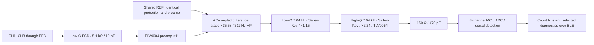
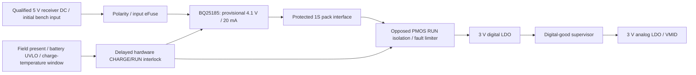

# CuraLink Rev A schematic and candidate PCB

**Design recorded 2026-10-01; sourcing, signal-integrity review and PCB creation 2026-10-02, America/New_York. Engineering candidate; not a PCB manufacturing release.**

**Restart check, 2026-10-09:** CAD is saved as KiCad, with no native Altium files. The PCB has placement and GND connections but unfinished signal routing/plane fill and stale schematic links. MCU placement corrections remain separate. The PDF/ZIP were generated before that later PCB/SI work; use the source folder and current reports for restart. The shared-4.7 Ω bias option passed nominal AC but its startup run did not complete and recovery/load checks remain unrun. Existing 47 Ω circuitry and accepted architecture decisions are unchanged.

This package defines an eight-channel bench prototype using the existing STM32WBA52 family, a discrete spike-band AFE, BLE, and the selected BQ25185 charger. The user authorized comparing ADC/comparator detection, building a reviewable schematic and subsequently creating a PCB. ADC detection is the recommendation; it has not silently superseded the handbook's previously accepted comparator baseline. The editable mainboard is a provisional implementation with open electrical/RF/assembly gates. No firmware, purchase or measured performance is included.

**PCB and signal integrity, 2026-10-02:** The [native candidate board](curalink-rev-a.kicad_pcb) has a provisional 80 × 74 mm four-layer placement and 446 assigned physical footprints. Its [PCB review](pcb/README.md) records routing/DRC status and manufacturer-land audits. The [SI review](signal-integrity/README.md) includes actual LTspice shared-VMID crosstalk at −52.22 dB worst and an assumed 0.01 pF late-output-to-input sensitivity. The proposed −60 dB criterion is not accepted or met; input loading, bias architecture and RF ground/stack adaptation remain open. A PCB file does not close these issues.

**LTspice verification and corrections, 2026-10-02:** [Actual DC/AC and protection analyses](ltspice/README.md) now include valid nominal amplifier equilibria, leakage-aware DC sweeps, frequency response, startup/recovery, eFuse fault transients and regulator-input peaks. Manufacturer audits corrected U502/U511 TPS25200 physical pins and D501 SS14 anode/cathode numbering; R511 is now stocked 1 MOhm +/-1% within TI resistance limits. Fresh schematic, pin tables, ERC, PDF and ZIP replace the earlier connections. CAD transfer checks alone cannot validate a manufacturer pin map.

## Start here

Open `curalink-rev-a.kicad_pro`, `curalink-rev-a.kicad_sch` and `curalink-rev-a.kicad_pcb`. The project has self-contained symbols/footprints and numbered physical pins. Global labels connect the sheets; a label is an electrical connection, not an annotation. `pin-net-connections.csv` gives each physical pin, net, value, source and population state. `bom.csv` is the procurement draft. `verification-report.json`, `erc-report.json` and `pcb/validation.json` state what was actually checked, with PCB DRC recorded separately.

The detailed calculations and primary evidence are in [AFE review](afe/AFE-design-review.md), [MCU/RF review](mcu/mcu-design.md) and [power review](power/power-design.md). Those files own detailed subsystem derivations; this README is the integration handoff. Consult the [engineering handbook](../../docs/engineering-handbook.md) for accepted requirements and decision history.

The PDF review includes the architecture and the complete schematic. Component pin tables are the main import cross-check; the PDF alone is not a fabrication input.

## LCSC stock and procurement

The [live inventory audit](procurement/stock-audit-2026-10-02.csv) checks all **80 unique BOM SKUs**, including DNP options and the off-board thermistor, against exact manufacturer numbers, immediate overseas inventory, sale/display flags, minimum orders and order multiples. All 80 have sufficient stock for **one board** on 2026-10-02. The [JSON evidence](procurement/stock-audit-2026-10-02.json) links the saved primary LCSC responses. `bom.csv` includes the checked date, inventory and direct product links; copper wire/test pads are PCB artwork and are excluded from procurement.

The external 18-contact, 0.5 mm, 50 mm same-side FFC cable **C6936300** is also stocked. The previously accepted cell **C19632326 / Taisko 401020-55mah is not confirmed globally orderable from LCSC**: its global detail record is null, product page returns 404 and exact-code search has no result. A JLCPCB parts-library listing does not establish standalone shipment. No compatible stocked global LCSC cell replacement was verified; cell sourcing and independent protection remain open. This is a procurement exception, not a silently accepted new battery. See the [external sourcing review](../../procurement/active-external-stock-review-2026-10-02.md).

Material small inventories: MCU **9** available for one required, TLV9054 **88** for two required, and 909 kΩ resistors **140** for 32 required (purchase 40 after the 20-piece order increment). This is not a stock reservation or a guarantee for a panel of several boards. Recheck before ordering; substitutions must preserve electrical limits, tolerances and physical pin/land-pattern mapping.

Minimum-order purchase cost is approximately **US$103.55** for the populated BOM, off-board NTC and cable minimum, or **US$106.11** if also buying DNP options. These are purchase-line costs, not fitted-component costs; the unconfirmed cell, PCB, assembly, feeder losses, shipping and tax are excluded. The under-US$150 assembled-prototype objective is therefore **not yet demonstrated**. Exact assembly-service eligibility also remains a quote check; LCSC inventory alone does not establish it.

## Objectives and criteria used

- Eight independent signal channels and one shared reference; one fixture waveform fanned out through eight nominal 47 kΩ branches.
- Preserve 100–300 µVpp primary signals, including the nominal 200 µVpp case, across approximately 300 Hz–7 kHz. Characterize 50–500 µVpp, ±100 mV DC offsets and larger excursions; the 20 µVpp stretch case is not guaranteed.
- Electronics noise ≤6 µVrms over 300 Hz–7 kHz, with source-resistor noise accounted for separately. Derive gain from output headroom, driver error and noise rather than copying another board.
- Preserve exclusive CHARGE and RUN, quiet analog power, one-hour eventual runtime, and the under-US$150 assembled-prototype objective.
- Use stocked LCSC PCB parts, correct package suffixes and physical pin numbering. Include tuning, isolation and observation because Rev A may be the only mainboard iteration.
- Retain every unmet requirement and qualify calculations separately from measurements. In particular, the ≥10 MΩ full-band input target remains unchanged and is **not met** by the proposed capacitance budget.

## Acquisition recommendation

| Option | Description | Pros | Cons |
|---|---|---|---|
| Analog comparators and MCU event capture | AFE feeds threshold/hysteresis comparators; firmware captures pulses and counts events. | Can avoid continuous waveform conversions; direct event timing; potentially less MCU activity. | Threshold/reference errors must be small compared with the noise; bipolar detection, hysteresis, re-arm and refractory behavior need additional circuits; little waveform evidence when debugging false counts. Lower total power has not been demonstrated. |
| STM32WBA52 ADC with digital detection | Sample all eight conditioned channels; estimate baseline and thresholds digitally; transmit normal count bins and short diagnostic records. | Programmable thresholds and polarity, channel calibration and waveform visibility; eliminates eight external detector circuits; uses the already selected MCU family. | ADC acquisition/aliasing must be engineered; BLE calibration may share the ADC; scan continuity and total system current require firmware qualification. Channels are multiplexed, not simultaneous. |

**Recommend ADC detection with STM32WBA52CGU6.** It gives much stronger observability for the first board and allows detection rules to change without respinning analog thresholds. This is a functional recommendation, not a demonstrated power victory over comparators. Keep the existing count-vector/bin concept; continuous raw BLE streaming is not promised. The MCU's internal ADC is used only in this proposed architecture.

The selected UFQFPN-48 device has nine external analog inputs; eight are wired to the AFE, with PA3 available as a spare pad. WBA52 has no SMPS. The WBA55 alternative's possible power advantage does not justify changing the accepted MCU family without measured whole-system evidence. [ST DS14127](https://www.st.com/resource/en/datasheet/stm32wba52cg.pdf)

## Signal path and component values

| Function | Circuit and nominal values | Why these values |
|---|---|---|
| Connector transient shunt | Three TPD4E05U06DQAR arrays; same protected path on CH1–CH8 and REF | Approximately 0.5 pF typical per used line limits added loading. DQA pins 3/8 are GND; 6/7/9/10 are intentional NC, not additional protection channels. |
| Current limiting and DC blocking | 5.1 kΩ series, 10 nF C0G ±1%, 22 MΩ return to VMID | Series resistance limits residual clamp/injection current; capacitor blocks steady electrode/fixture DC. The bias pole alone is about 0.72 Hz and does not define the spike-band high-pass. |
| Input preamplifier | Non-inverting TLV9004, 1 kΩ to VMID and 10 kΩ feedback | Gain 11 reduces downstream noise while leaving room for input startup/offset excursions. REF uses the same circuit. |
| Difference/high-pass stage | Matched CH/REF 10 nF and 51.1 kΩ inputs; feedback/balance each two 909 kΩ ±0.1% resistors in series | Effective feedback/balance 1.818 MΩ, gain 35.58, high-pass about 311.46 Hz. The series pair is an explicitly stocked substitute, not a fictitious 1.8 MΩ part. |
| Low-Q low-pass | Equal 22.6 kΩ / 1 nF C0G arms; gain 1 + 1.5 kΩ/10 kΩ = 1.15 | Q ≈0.541; first Butterworth-like pole pair. Use matching placement/tolerance on the two arms. |
| High-Q low-pass / ADC driver | Equal 22.6 kΩ / 1 nF arms; gain 1 + 12.4 kΩ/10 kΩ = 2.24; TLV9054 | Q ≈1.316. The 5 MHz amplifier is used here because its output must recover from ADC sampling transients. |
| ADC local interface | 150 Ω series, 470 pF C0G ±5% at each MCU ADC pad | Isolates the final amplifier and supplies sampling charge. It is not the 7 kHz anti-alias filter. |
| Midpoint | Quiet 3 V / 2 divider, RC filter, TLV9004 buffer and isolated capacitive load | Centers the single-supply signal around 1.5 V. VMID is neither an ADC reference pin nor a ground substitute. |

There are seven TLV9004IRUCR and two TLV9054IRUCR packages: 36 powered amplifiers, 34 used and two closed-loop spare followers. Do not leave unused amplifiers open-loop. The RUC package is a 2 mm × 2 mm X2QFN-14 with 0.4 mm pitch and **no exposed pad**. Its pin numbering differs from the TSSOP-14 versions. The generated symbols use the RUC mapping, not a generic quad-op-amp pinout. [TI TLV9004](https://www.ti.com/lit/ds/symlink/tlv9004.pdf), [TI TLV9054](https://www.ti.com/lit/ds/symlink/tlv9054.pdf)

## Predictions and their practical limits

These numbers are model calculations, not a test report. The small-signal model includes source resistance, input/FFC capacitance, finite amplifier GBW, resistor noise and typical amplifier noise fits. It treats VMID as ideal and omits rail clipping, nonlinear recovery, PCB leakage, supply noise and the real ADC transfer function.

| Quantity | Calculated candidate result / assumption |
|---|---|
| Nominal gain product | Approximately 1008 V/V (60.1 dB) |
| Actual modeled gain at 1 kHz | Approximately 969 V/V including finite GBW and nominal 47 kΩ source / 20 pF FFC |
| Nominal 200 µVpp at 1 kHz | Approximately 194 mVpp at ADC, centered near 1.5 V |
| 1 mVpp headroom test | Approximately 0.969 Vpp at 1 kHz; initial qualification range 0.2–2.8 V at ADC |
| Band edges | About −3.16 dB at 300 Hz and −3.11 dB at 7 kHz relative to nominal gain |
| Electronics noise, 300 Hz–7 kHz | About 3.44 µVrms, output divided by modeled 1 kHz gain; frequency-referred integral about 3.51 µVrms |
| Two 47 kΩ source resistors | About 3.17 µVrms by the same gain convention; about 4.68 µVrms total with electronics in quadrature |
| Amplifier current | 4.32 mA typical; 5.70 mA room-temperature datasheet maxima sum, excluding divider, MCU and control loads |
| Ideal ADC quantization only | 3 V / 4096 = 732 µV/code at MCU, or about 0.756 µV/code referred to input; actual ADC noise/ENOB differ |
| Filter rejection vs 1 kHz | About 43.6 dB at 23 kHz and 69.4 dB at 43 kHz; 50 kS/s per channel moves the first alias into the 7 kHz passband to 43 kHz |

Gain is appropriate for the primary signal envelope and leaves useful headroom. A 20 µVpp signal is only about twice the calculated total-noise RMS in peak amplitude; no dependable stretch-case event detection is claimed. Detection probability, false-count rate, polarity, dead time and thresholds must be validated using actual spike waveforms and noise.

**Prefer 50 kS/s per channel as the qualification target.** The first alias into the 7 kHz passband then starts at 43 kHz, with about 68.6 dB in the LTspice family model; a 1 mVpp blocker contributes about 0.37 µVpp input-equivalent. At the 30 kS/s lower-rate alternative, a 1 mVpp blocker at 23 kHz contributes about 6.6 µVpp, so adopting that rate requires a tighter out-of-band stimulus envelope. Higher rate increases ADC/processing activity and the internal data stream; measure the power tradeoff. Neither rate gives blanket alias immunity. BLE/RF ingress at GHz frequencies is outside the validity of this lumped audio-band model.

### Actual LTspice results, 2026-10-02

The [runnable LTspice evidence](ltspice/README.md) complements the earlier calculations. All 36 amplifier operating points are valid using original-equation TI TLV9002/TLV9052 family macros for the selected quad units. Actual simulated gain is 969.744 V/V at 1 kHz, with sampled peak-relative -3 dB band about 316 Hz-6.88 kHz. At 23/43 kHz, attenuation is 43.13/68.59 dB versus 1 kHz. These are nominal model results with declared cable/parasitic assumptions, not noise or ADC accuracy measurements.

Across -100 to +100 mV steady offset, the 10 GOhm coupling-capacitor insulation scenario changes the ADC baseline by 18.36 uV. DC blocking does not prevent step artifacts: later stages rail and an unexcited channel sees about 8 mVpp through shared VMID. Cold startup reaches the quarter-ideal-LSB settling check after 2.336 s; recommend a **Candidate 3 s startup blank plus whole-AFE rail/baseline/clipping validity checks**. The tested offset sequence recovers within that check after 1.585 s, but no fixed delay is qualified across hardware/corners. 50/60 Hz differential attenuation is only about 15.7/14.1 dB, so this circuit is not a mains notch.

The eFuse fault fixtures show clamping near 5.40 V and cutoff at high input, with fast-fault CHG_IN overshoot up to 5.868 V in the declared minimum-capacitance case. The actual diode-fed control-LDO input is checked separately and remains below 6 V in those runs. This does not protect an unbounded raw RF reservoir, arbitrary PACK+ faults, externally driven AFE pins or a failed LDO output. BQ25185 charging and real cell behavior have no validated LTspice macro here.

### Input loading: unresolved requirement

A purely capacitive 10 MΩ impedance at 7 kHz permits only C = 1/(2π·7000·10 MΩ) ≈2.27 pF, before any parallel bias resistance. The proposed amplifier input, ESD, traces and FFC exceed this. The calculated input impedance is about 3 MΩ at 7 kHz even with zero FFC capacitance; the 20 pF FFC example is lower still.

The proposed alternative acceptance criterion is ≤1% amplitude loss and ≤5° phase error with 47 kΩ sources, and ≤2% / ≤10° with 100 kΩ, with cable/board capacitance characterized. At 20 pF nominal cable capacitance, the model predicts approximately 0.42% / 3.3° at 47 kΩ and 1.2% / 6.9° at 100 kΩ at 7 kHz. **This alternative is awaiting the user's decision and has not changed the handbook requirement.** If ≥10 MΩ remains mandatory, reopen the passive FFC interface and consider locating buffers at the fixture/electrode interface; do not release this candidate as meeting it.

Component matching alone does not establish common-mode rejection. In 300 tolerance trials the ideal matched-cable model's minimum CMRR at 1 kHz was about 50 dB. A 5 pF CH/REF capacitance mismatch reduces modeled CMRR to roughly 40 dB at 7 kHz. Match CH and REF routing, connector/ESD/coupling networks and fixture source impedances, and test common-mode injection. Define the allowed common-mode signal before claiming a rejection requirement is satisfied.

### ADC settling, timing and startup

The final driver was tested with an adapted TI TLV9052 family macro-model in ngspice, not a model of the complete MCU ADC. Alternating 2.8↔0.2 V with assumed 5/10 pF sample capacitors, 1 kΩ sampling switch, 150 Ω ±1% and 470 pF ±5% gave worst residual 24.3 µV (0.033 ideal LSB) at 1.656 µs acquisition. Across a 1.5–1.8 µs window the worst was about 107 µV (0.146 LSB), reducing the risk of selecting a ringing zero crossing. This is a typical-model candidate; the real ADC, amplifier process/temperature and board parasitics remain tests. The full TLV9002-family model failed operating-point validity in this ngspice adapter; its successful process exit is **not** a passed nonlinear AFE simulation.

Separate 2 ms periodic tests at the preferred 50 kS/s evaluated the 1/7 kHz waveforms and relevant sampling phases. Additional settling error was ≤4.30 µV, but total error relative to the instantaneous quiet ADC input, including the modeled SAR tracking delay, reached **196.83 µV / 0.269 LSB** for the 7 kHz / 10 pF case. That **does not pass a ¼-LSB total-error target**. It is about 0.20 µV referred through the 1 kHz gain, small compared with the calculated analog noise, so retain the circuit as a qualification candidate with this explicit limitation; do not label real ADC dynamic accuracy proven. See `afe/adc-stress-50k/results.json`.

The preferred timing target uses 48 MHz ADC clock and 79.5-cycle acquisition: 1.656 µs acquisition plus 12.5-cycle conversion gives 1.917 µs/channel and 15.33 µs for eight channels, fitting a 20 µs frame at 50 kS/s per channel before trigger/sequence overhead. The 16-bit internal data stream is then about 800 kB/s. The ADC4's allowed long temperature-sensor setting is **814.5 cycles**, not 639.5; temperature sampling/conversion needs about 17.23 µs at this clock before startup/reconfiguration overhead. It cannot be inserted into each 20 µs neural frame. Even a 30 kS/s alternative leaves only about 0.77 µs after eight neural samples and this temperature conversion. A separate explicit calibration-service policy is required; gap-free BLE service is **not established**.

Use a single ADC owner, validate the exact WBA52 BLE stack release, and schedule/calibrate acquisition explicitly. Either prove continuous scanning under BLE service or record bounded gaps and count validity. No firmware solution is supplied here. The proposed 48 MHz PLL clock requires Run/Sleep, not autonomous Stop0; changing to an autonomous clock requires recalculating acquisition and scan timing. Prove ADC/timer/DMA behavior and measure current in the actual clock/power configuration.

Bias startup and a ±100 mV input DC step can clip downstream stages. The actual nominal LTspice cold-start test requires 2.336 s to reach a quarter ideal ADC LSB; the earlier 2 s proposal fails that check. Recommend a Candidate 3 s startup blank, then accept counts only after supplies, midpoint, channel baseline and clipping diagnostics are valid. Blank and validate the shared AFE after saturation or FFC reconnection; the tested offset sequence recovers within that check after 1.585 s, but no fixed delay is guaranteed across hardware/corners. Comparator pulse capture would need equivalent recovery protection.

## Power integration

The charger, cell and rail partition stay aligned with the established baseline. Opposed PMOS devices provide bidirectional OFF isolation; negative VGS turns them ON. WPT present disables RUN regardless of charge-complete status. Charge is enabled only after the RUN path has turned off and discharged, and the cell-mounted NTC is within the charge window.

The normal board input is qualified 5 V DC, **not an unbounded RF reservoir**. Initial assembly has bench input R543 fitted, receiver link R542 DNP and independent cell PCM U514 DNP. J501–J504 are labelled copper wire pads, not unspecified assembled connectors. Use current-limited bench DC and a battery emulator for initial bring-up; insulate and strain-relieve harness wires.

RT501 is an off-board, cell-mounted thermistor; `bom.csv` marks it **OFFBOARD_MANUAL**. Exclude it from the main PCB pick-and-place file and install it through the protected-pack/NTC harness. LCSC stock does not turn this leaded sensor into a PCB ambient-temperature substitute.

- BQ25185 ISET 15 kΩ gives nominal 20 mA; VSET 130 kΩ selects provisional 4.1 V and the 500 mA charger input-limit code. These are distinct settings. The external eFuse limits fault current but does not prove a 50 mA cell-safe cutoff.
- Allocate at least **120 mW at the 5 V mainboard input** as an initial charging qualification target, above the earlier 105 mW nominal estimate. Final receiver matching, rectifier reverse stress, reservoir overvoltage and delivered DC power remain unqualified.
- Battery UVLO is approximately 3.50 V falling / 3.80 V restarting. Its conservative corners and regulator drop/ripple mean usable capacity is smaller than nameplate capacity and must be measured.
- Analog LDO enable waits for digital supply good, nominally 1.53 V rising / 1.43 V falling. Both rails actively discharge on NOT_RUN. Check the actual STM32 supply and ADC-input bounds during transitions and with external tools connected.
- Charge temperature window is about 21.9–35.9 °C nominal, with examined conservative threshold corners. The NTC must be mounted thermally to the cell; a PCB ambient thermistor is not equivalent.
- A 15 mA measured average needs ≥15 mAh usable capacity for one hour; 25 mA needs ≥25 mAh. Neither 55 mAh nameplate nor an assumed MCU idle mode establishes this.

**The cell protection gate is real:** the stocked optional BQ29737 circuit's guaranteed voltage/current tolerances do not establish compliance with the selected 401020 cell's manufacturer limits. It is drawn but DNP. Obtain a documented compatible protected pack or revise protection with manufacturer-supported limits before using a lithium cell. BQ25185 OVP/OCP are useful but do not replace protection of the external battery RUN path. The power report gives exact thresholds and the incompatibility calculation.

## BLE/RF and layout handoff

MCU RF feeds MLPF-WB-04D3; its A1-to-MCU line is specified as **63 Ω**, while its A3 output side is **50 Ω**. Follow ST's package and ground-via layout. Initial Johanson antenna tee is 1 pF series, 2.7 nH shunt and 3.9 nH series. These values are a vendor-layout seed, not a match on CuraLink's board. Antenna pad 2 is soldered to an isolated mechanical pad, never GND. Keep the vendor antenna clearance on every layer and away from battery, WPT coil and FFC.

HSE is an NDK 32 MHz crystal using the MCU's internal adjustable load capacitors; do not add generic external HSE capacitors. LSE is 32.768 kHz with initial 4.7 pF loads requiring startup/load qualification. VCAP uses 4.7 µF and VDDHPA uses 470 nF to GND; both are internal regulator outputs and must not be externally supplied. The exact MCU physical mapping is in `mcu/mcu-pin-map.csv`.

Use a four-layer mainboard candidate with an uninterrupted return plane and compact analog/RF/charger regions. Do not split GND under signal/RF paths; separate noisy current loops spatially. Keep ADC, crystals, RF bypass and regulator capacitors at their physical pins. Keep high-impedance CH/REF and difference-stage nodes short, clean and protected from flux/moisture; 22 MΩ makes leakage consequential. Route the two feedback/balance resistor pairs and coupling/filter capacitors symmetrically. Guarding may help leakage but adds capacitance; model and measure that tradeoff.

Place test access at input/preamp, difference stage, final AFE, ADC input, VMID, rails and all power permissions. Test pads themselves add parasitic capacitance; prefer small pads and high-impedance/low-C probes on input nodes. Debug signals include removable series links and target-voltage-reference pads. Do not apply debugger/USB/DAC drive while the system is off unless measured backfeed limits and isolation are satisfied.

A 25–30 mm outline remains an objective. This schematic has many discrete passives, a 7 mm MCU, a wide FFC connector and antenna clearance; no placement proof is provided. Increase board area rather than squeeze analog/RF returns or unverified high-impedance routing. LCSC availability does not automatically mean the assembly service can mount an X2QFN-14 or this RF CSP.

## References reused and rejected

The [EGRA checkpoint](https://github.com/zanebeeai/egra-og/blob/b915129b144de0e52f8daf5e31ab55e3a1aaabc2/egra-OG_1.before-routeplan-20260601_181915.kicad_pcb) informed connector-side ESD, source-path symmetry and modular separation. Its 4.7 nF electrode shunt is inappropriate for a 47 kΩ source and 7 kHz spike band, so it is not copied. The inspected checkpoint has no completed routing/outline to validate a CuraLink layout. [Meower](https://github.com/nikki-uwu/Meower/tree/c6f410268a16cf4e0ecb313ea7b957a4a2afa690/hardware) informed observability and test practice; EEG/ADS1299 component constants are not this spike-band specification. See the [source audit](../../docs/design/2026-09-22-egra-meower-reference-audit.md). This is a new schematic, not a relabelled source board.

## Altium import, assembly and verification

Altium's [KiCad importer](https://www.altium.com/documentation/altium-designer/design-tools-interfacing/kicad-import) supports KiCad schematic/project import when the importer is installed. Import the project into a new Altium project, retain physical pin numbers/global labels/population notes, and then compare the exported Altium connectivity to `pin-net-connections.csv`. A successful importer dialog is not a connectivity check.

Symbols in this package deliberately separate exact pin mapping from PCB land patterns. **Do not send this draft straight to assembly.** The native project now assigns checked footprints; audit their transfer, manufacturing process and exact-suffix pad orientation in Altium, especially X2QFN RUC op amps, MCU EP, charger/eFuse EPs, RF CSP ball orientation, crystal case pads, antenna anchor and FFC contact orientation. `footprint-audit.csv` tracks that work. Verify the 50 mm FFC candidate end-to-end: pin 1, contact face, every CH/REF/GND and no swapped conductor. Both fixture and mainboard use the same 18-pin map: odd pins 1–15 are CH1–8, intervening even pins are GND, pin 17 REF and pin 18 GND.

Release sequence:

1. Resolve the input-loading requirement, globally orderable cell and compatible battery protection. Recheck the dated LCSC inventory, exact assembly-service availability and complete quote against US$150; the quote is not yet obtained.
2. Import/audit schematic pins and footprint pads; decide populated options. Never fit bench/receiver links together or both RF branches. Keep optional PCM DNP until independently qualified.
3. Complete PCB placement, analog/RF return and clearance checks, DRC, effective MLCC capacitance audit and manufacturing review. Preserve the test/isolation points.
4. Bring up control and regulators from current-limited emulators, then prove CHARGE/RUN delays, UVLO, open/short NTC, rail sequencing, no-load/current faults and debugger/DAC backfeed. Measure rails and CE simultaneously.
5. Inject the actual specified source-resistor/spike/offset cases. Measure gain, band edges, electronics noise, input loading/phase, common-mode rejection, clipping/recovery and interchannel coupling; drive one channel at a time for crosstalk, not only the shared waveform.
6. Prove ADC settling, calibration ownership and scan continuity under BLE traffic. Measure system current, usable cell runtime and actual antenna performance in the final mechanical arrangement.
7. Qualify the separate WPT receiver with load/no-load/alignment and DC-power/stress tests before connecting it through R542. The published coil link's approximately 70% efficiency is not CuraLink's charging efficiency.

## Reproducing the artifacts

`tools/hardware/build_stock_audit.py` consolidates saved primary stock responses and verifies exact SKUs and quantities against the BOM; it does not make new network requests. `tools/hardware/build_reva.py` merges the subsystem pin maps, stocked passive catalog and dated inventory, then generates symbols, sheets, BOM and CSV. KiCad 9 CLI exports the netlist and ERC report. `tools/hardware/verify_reva.py` compares every pin against the actual CAD netlist and checks the MCU internal outputs, ADC interfaces, PMOS topology, CE permissions, ESD mapping and DNP source isolation. Model scripts and vendor-model provenance are under `afe/`. Re-run after any value, pin, net or population change; checks do not certify unmodeled hardware performance.
