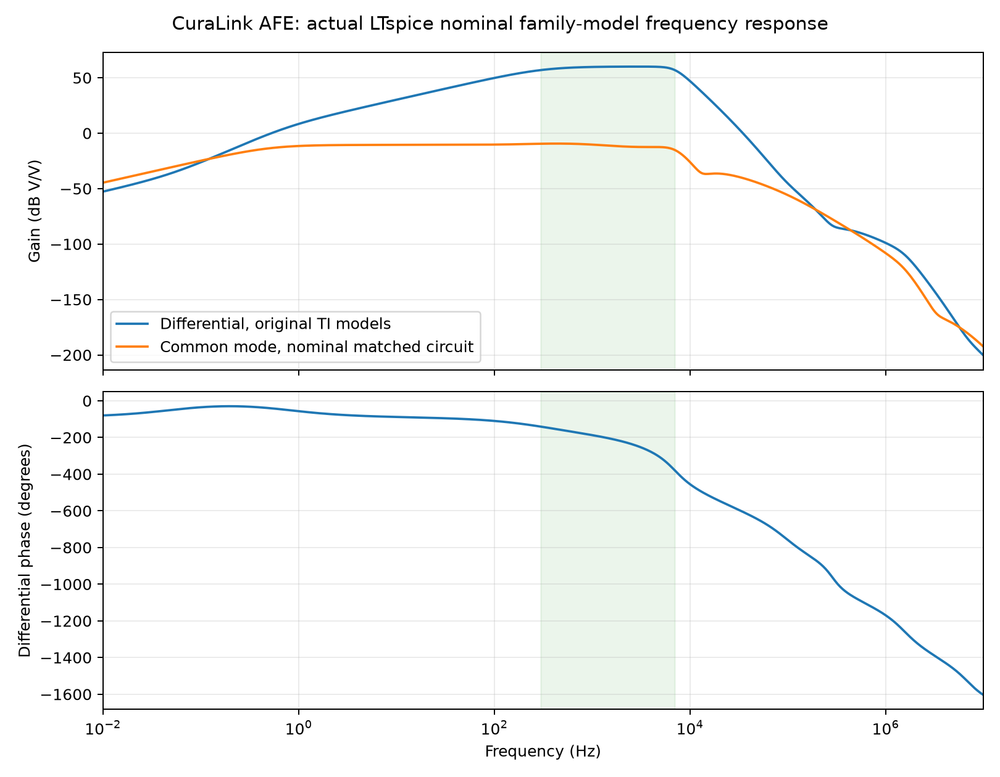
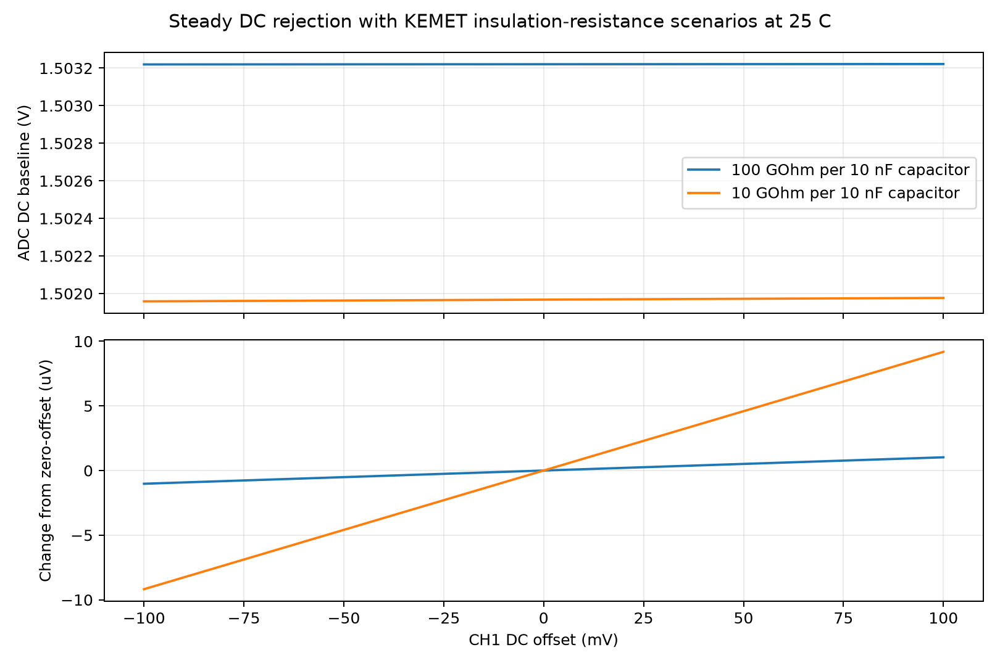
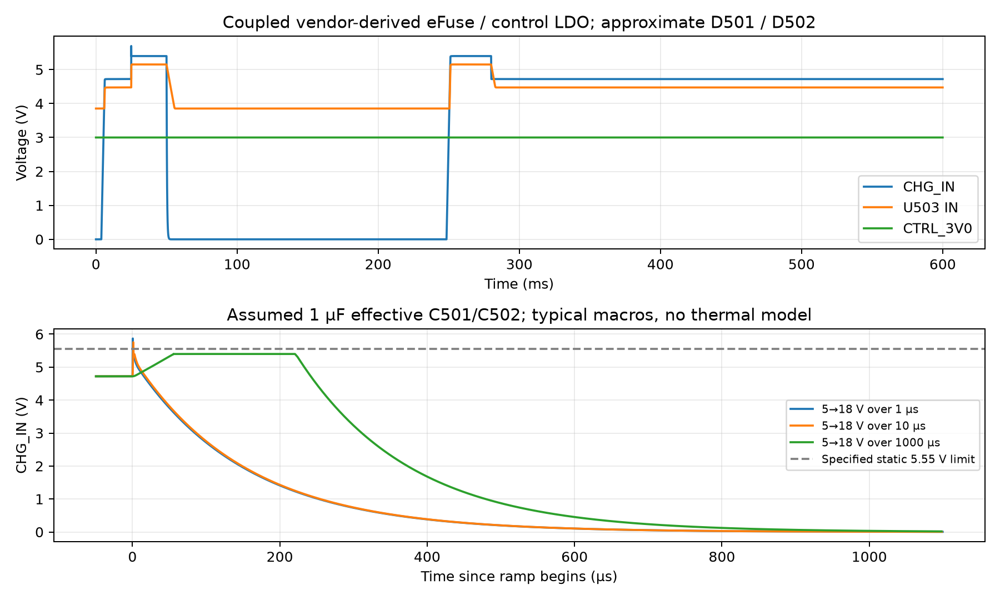

# CuraLink: actual LTspice DC, frequency and protection analyses

**Executed and recorded 2026-10-02, America/New_York. LTspice 26.0.2 for Windows. Nominal model evidence; the schematic remains a Candidate implementation.**

The requested DC sweeps and frequency-response runs are complete. The AFE rejects steady input DC and has the intended spike-band gain. The eFuse provides downstream voltage clamping and fault cutoff in the tested power fixtures. DC blocking still passes offset steps, and the modeled OVP has finite response time: neither result establishes universal fault survival.

## Objectives, fixtures and results

The checks use the canonical eight-channel/shared-REF topology, declared 47 kΩ source branches and 20 pF cable capacitance, 3 V analog supply, and the exact nominal passive values. Acceptance is based on finite results, valid amplifier operating points, ADC baseline variation and actual protected-node voltage. Hardware, passive/PVT extremes, cell chemistry and omitted interface faults remain separate checks.

| Check | Actual result | Conclusion and boundary |
|---|---|---|
| Full AFE operating point | All 36 amplifier units valid; ADC outputs 1.503360 V, VMID 1.500596 V; 4.474 mA modeled draw | Original-equation TI dual-family macros represent the selected quad units; excludes MCU/control draw and package effects. |
| Ideal-capacitor DC sweeps | Differential −100…+100 mV and common −300…+300 mV leave the settled ADC baseline unchanged | Verifies the modeled DC paths; ideal capacitors alone cannot prove physical leakage rejection. |
| Declared capacitor insulation scenarios | ADC baseline changes 2.05 µV / 18.36 µV over the full 200 mV input span with 100 GΩ / 10 GΩ across each coupling capacitor | Both are below 183 µV, a quarter ideal 12-bit LSB at 3 V. These are explicit 25 °C datasheet-based scenarios, not PCB leakage guarantees. |
| Differential frequency response | 969.744 V/V at 1 kHz; peak 1006 V/V at 2.90 kHz; sampled peak-relative −3 dB band 316 Hz–6.88 kHz | Supports the nominal gain/band design. Noise and real ADC accuracy are not established by AC analysis. |
| Differential interference | 50/60 Hz attenuation 15.7/14.1 dB; 23/43 kHz attenuation 43.13/68.59 dB, all versus 1 kHz | DC rejection does not provide a mains notch or blanket alias/RF immunity. |
| ±100 mV offset steps | ADC 0.0149–2.9851 V; about 8 mVpp artifact on an unexcited channel through shared VMID | Blank the shared AFE during artifacts. The tested final recovery reaches the quarter-LSB check after 1.585 s. |
| Cold startup | Quarter-LSB settling after 2.336 s; 2 s residual −531 µV | The previous 2 s startup proposal fails this nominal check. Recommend a **Candidate 3 s startup blank plus rail/baseline/clipping validity checks**; no universal delay is qualified. |
| Independent eFuse startup | RAW 5 V gives CHG_IN 4.722 V; RAW 6.5 V gives 5.399 V; higher tested inputs turn off | Typical macro result, not guaranteed silicon thresholds. RAW includes the SS14 drop before eFuse IN. |
| Fast OVP fault with minimum assumed capacitance | A 1 µs RAW 5→18 V ramp gives CHG_IN peak 5.868 V; actual control-LDO input 4.650 V | Overshoot exceeds the static clamp limit. Tested regulator-input peaks remain below its 6 V normal limit; 18 V is a stress fixture, not an approved board source. |

## Protection corrections made in the schematic

Manufacturer pin audits found errors that source-to-CAD transfer checks and ERC could not detect. The corrected handoff uses **TPS25200 OUT1, ILIM2, FAULT3, EN4, GND5, IN6, EP GND** on U502/U511, and **onsemi SS14 anode 1 / cathode 2** on D501. R511 is now the already-stocked **1 MΩ ±1% / C26083**, so its 1.01 MΩ maximum stays below TI's allowed 1.1 MΩ resistance ceiling. Approximate current-limit bounds are 56.9–138.4 mA; this is not a guaranteed 50 mA cell protector.

The refreshed connectivity comparison checks 1,089 connected pins and 48 intentional NC pins on 446 physical components. KiCad ERC has zero findings. Exact manufacturer-pin invariants have been added for the repaired parts. The earlier eFuse/SS14 exports are superseded; land-pattern mapping and assembly orientation still need their own Altium audit.

## What is protected, and what remains open

U502 supplies downstream clamping/cutoff; U511 limits downstream RUN faults. The input eFuse cannot clamp the coil/rectifier/raw reservoir before it. PACK+ also feeds charger BAT, control and PMOS branches before the RUN eFuse, so arbitrary pack overvoltage is outside that protection. No independent precision rail OVP is present for an LDO failed high, and the AFE ESD array is not a precision 3 V signal clamp.

Keep the initial 4.75–5.25 V current-limited bench source, qualified battery emulator and DNP RF/optional cell protector configuration. Real lithium operation still needs a compatible independent protector or documented protected pack. Unpowered FFC/debug drive, ESD pulse survival, effective capacitance at fault bias, simultaneous CHARGE/RUN timing and actual hardware recovery remain qualification gates. The unchanged ≥10 MΩ input requirement is still unmet by the present capacitance budget.

There is no validated BQ25185/cell LTspice model in this package. Power fixtures use declared loads; they do not simulate charging CC/CV, DPM, termination, usable capacity or chemistry. The control-LDO accuracy near the lowest UVLO corner remains open because the diode drop can reduce its input headroom.

## Models, detailed evidence and reproduction

- [AFE report and original-equation model provenance](afe/AFE-LTspice-review.md): DC, AC, common-mode, leakage, startup and recovery; [machine-readable results](afe/results.json), decks, raw files, logs and CSV under `afe/`.
- [Power report](power/README.md): vendor-derived transient macros, separate authored datasheet-bound static DC fixtures, LDO regulation/PSRR, comparator hysteresis and protected-node fault peaks; [machine-readable results](power/results/power-results.json).
- [Independent physical-pin and protection audit](protection-audit.md): exact manufacturer packages, absolute/normal bounds, upstream branches and interface limits.
- [Independent LTspice linear reference](linear-reference/results.json): finite-GBW circuit agrees with the existing MNA calculation to numerical precision and differs from the vendor-model 1 kHz gain by about 0.101%.

The original model archives, documented adaptations and source/circuit/raw hashes are preserved. A TPS25200 transient-macro `.dc` run that returned NaNs and an incomplete poor-leakage AFE diagnostic are explicitly rejected, not counted as passing results. The earlier ngspice full-AFE adapter failure remains historical invalid evidence; the valid LTspice operating point resolves that simulation-port problem.

The subsystem reports include reproducible commands. For an individual deck, run LTspice with `-b -ascii` in its folder and inspect both the log and finite raw data. Each deck includes its stimulus and assumptions. A successful process exit alone is insufficient. Plots are generated by the supplied analysis scripts and are based on the saved actual raw data.

Primary references include [TI TLV9004](https://www.ti.com/lit/ds/symlink/tlv9004.pdf), [TI TLV9054](https://www.ti.com/lit/ds/symlink/tlv9054.pdf), [KEMET C0G insulation specifications](https://content.kemet.com/datasheets/kem_c1003_c0g_smd.pdf), [TI TPS25200](https://www.ti.com/lit/ds/symlink/tps25200.pdf), [TI TPS7A20](https://www.ti.com/lit/ds/symlink/tps7a20.pdf) and [onsemi SS14 package/rating](https://www.onsemi.com/download/data-sheet/pdf/ss19-d.pdf). The detailed reports preserve page/section references and retrieval records.
