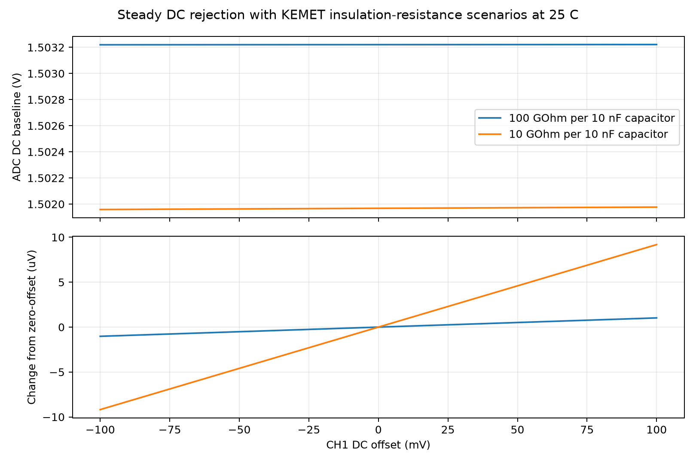
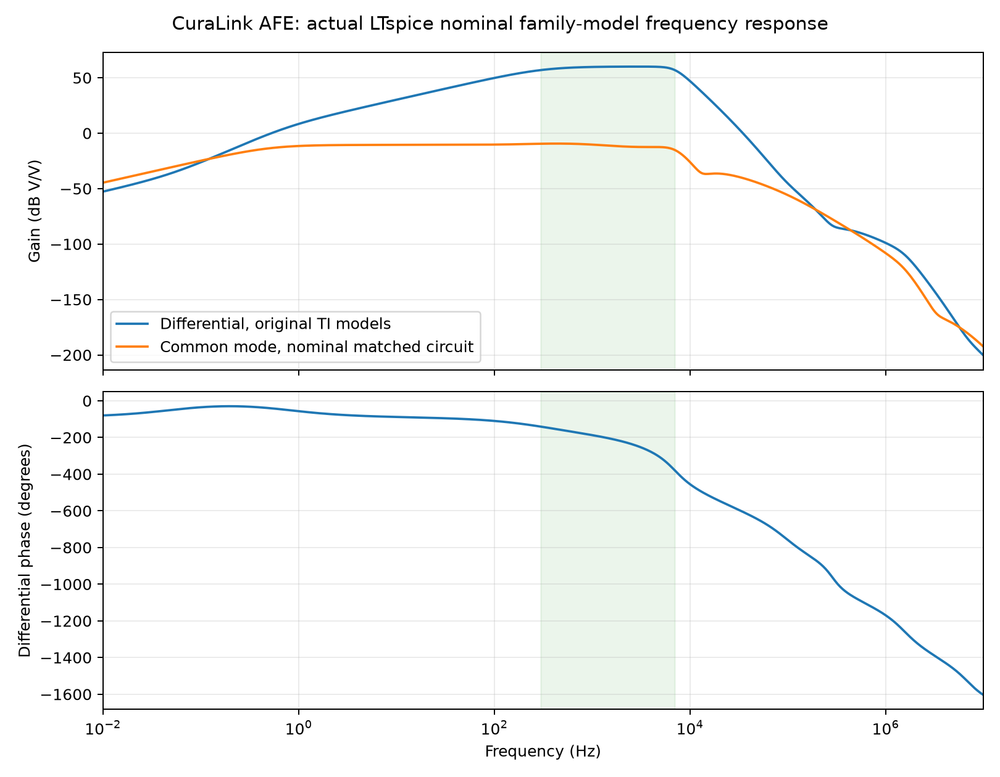
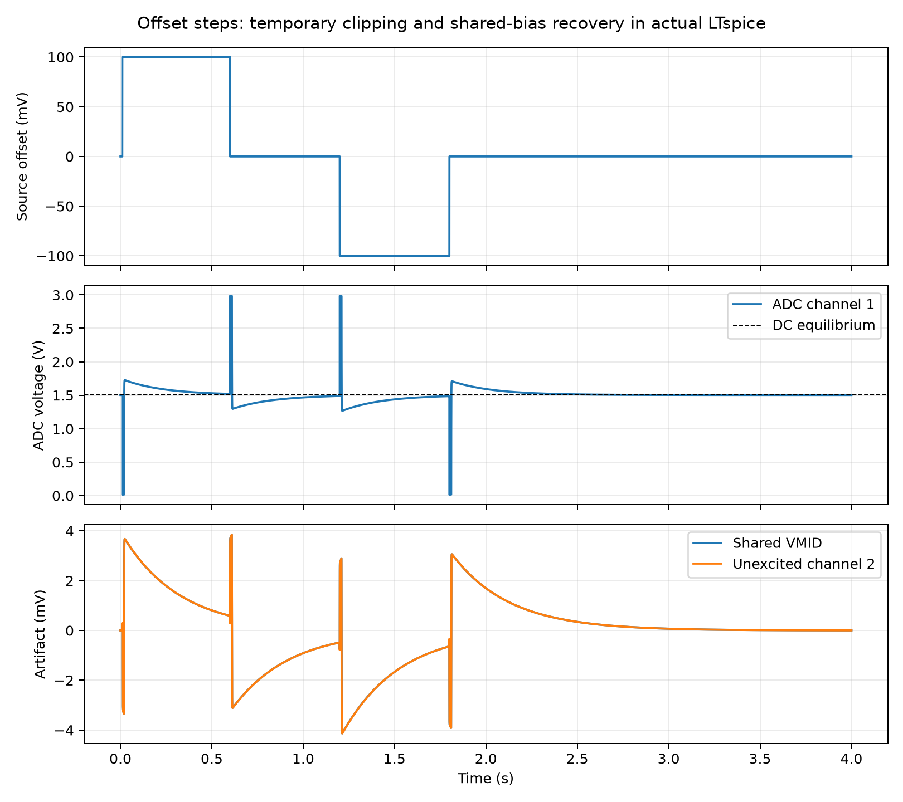
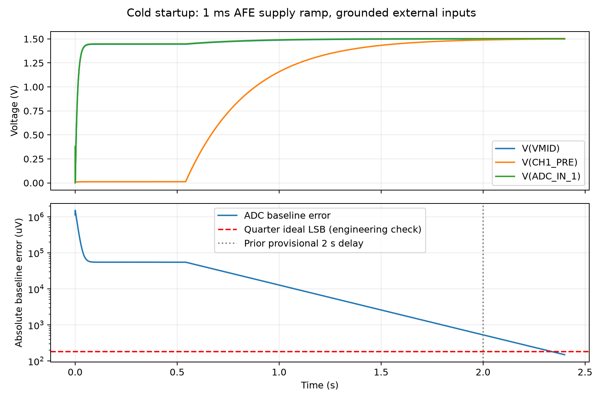

# CuraLink AFE: actual LTspice DC and frequency analysis

**2026-10-02, America/New_York. Nominal family-model simulations; no hardware measurement or manufacturing release.**

The complete eight-channel AFE now has a valid operating point in actual LTspice with the original TI model equations. Steady DC rejection passes the tested offset and capacitor-insulation scenarios. An offset step still temporarily clips the signal path and disturbs the shared midpoint. Cold startup takes longer than the earlier provisional 2 s delay to meet the quarter-LSB baseline check.

The results, exact values and file hashes are in [results.json](results.json). [Frequency CSV](frequency-response.csv) contains the full complex differential/common-mode transfer functions. All completed runs retain their `.cir`, `.log` and ASCII `.raw` files. This analysis does not change the canonical schematic.

## Model and topology

LTspice reports **26.0.2 for Windows**; executable file/product versions are 26.0.2.1 / 26.0.1.1. It was run with hidden `Start-Process -WindowStyle Hidden -Wait` and `-b -ascii`.

The original [TI TLV9002 Rev. C model](https://www.ti.com/lit/zip/SBOMAL2) and [TLV9052 Rev. D model](https://www.ti.com/lit/zip/SBOMAO0) represent each TLV9004/TLV9054 amplifier unit. Both model revisions are dated June 2021. Original files are copied unchanged. The derived libraries only prefix model/subcircuit identifiers so the two families' global helper names cannot collide; no equations, noise helpers, temperatures or resistor syntax are changed. See [model provenance](models/model-provenance.json). This is a family model, not a package, mismatch, process or temperature-corner model of the purchased quad devices.

The deck extracts the canonical physical pin/net data: 36 amplifier units, eight channels, shared REF and VMID, unused followers, exact passive values, 10 kΩ / 10 kΩ / 2.2 µF midpoint source, and eight MCU 150 Ω / 470 pF interfaces. Each external source uses 47 kΩ, with assumed 20 pF FFC, 2 pF trace and 0.5 pF ESD capacitance. Sources are ground-referred; settled coupling capacitors develop the required bias voltage. Grounded external inputs are not forced to 1.5 V.

The ESD array is represented by capacitance only. A qualified TPD4E05U06 fault/clamp model, PCB surface leakage, MCU switched-capacitor core, power regulator/interlock, digital activity and mechanical RF coupling are absent. Supply is an ideal 3 V except the explicit startup ramp. Passives are nominal. AC is a normalized small-signal analysis around the inspected equilibrium, not a physical 1 V neural stimulus.

## Verified equilibrium and DC rejection

All 36 amplifiers have outputs between **1.500398 and 1.503767 V**, valid input common modes and maximum input differential **0.3984 mV**. All eight final outputs are **1.503360 V**. VMID is **1.500596 V**. Modeled supply current is **4.474 mA**, including the midpoint divider and nominal loads; it does not establish worst-case current or package-level quiescent behavior.

| Test | Completed result | Interpretation |
|---|---|---|
| CH1 DC offset −100 to +100 mV, ideal capacitors | ADC remains about 1.503358 V; numerical span below 2 × 10⁻¹⁵ V | Steady DC is blocked in the ideal-capacitor circuit; this alone would be a trivial capacitor result. |
| Common DC offset −300 to +300 mV, ideal capacitors | ADC remains about 1.503358 V | Useful beyond-baseline offset check; not input ESD/fault protection proof. |
| 100 GΩ across every 10 nF coupling capacitor at 25 °C | −100…+100 mV produces **2.05 µV total ADC-baseline change** | Passes the quarter-ideal-LSB variation check; all preamps remain in range. |
| 10 GΩ across every 10 nF coupling capacitor at 25 °C | Same sweep produces **18.36 µV total change** | Also passes; approximately 0.025 ideal LSB. |

The [KEMET C0G datasheet](https://content.kemet.com/datasheets/kem_c1003_c0g_smd.pdf), page 4, gives the smaller of 1,000 MΩ·µF / capacitance and 100 GΩ as the initial 25 °C insulation limit, tested at rated voltage after 120 ±5 s. For 10 nF this is 100 GΩ. The listed post-environment limit is 10% of the initial limit. Modeling those limits as ohmic parallel resistors is an explicit scenario; it does not guarantee actual leakage at every temperature/voltage, independent mismatches or contamination around high-impedance PCB nodes.

## Frequency response

The 0.01 Hz–10 MHz sweep is complete and finite. Exact 1 kHz gain is **969.744 V/V**, only 0.101% above the existing 968.762 V/V linear reference. The sampled peak is about **1006 V/V at 2.90 kHz**. The sampled peak-relative −3 dB band is approximately **316 Hz–6.88 kHz**; these sampled endpoints are not precise corner measurements.

| Frequency | Differential gain | Relative to 1 kHz |
|---|---:|---:|
| 0.01 Hz | 0.00232 V/V | −112.4 dB |
| 1 Hz | 2.613 V/V | −51.4 dB |
| 50 Hz | About 160 V/V | About −15.7 dB |
| 60 Hz | About 191 V/V | About −14.1 dB |
| 300 Hz | About 703 V/V | −2.80 dB |
| 7 kHz | About 704 V/V | −2.78 dB |
| 23 kHz | About 6.76 V/V | −43.13 dB |
| 43 kHz | About 0.361 V/V | −68.59 dB |

Values outside the exact 1 kHz grid point use log-frequency magnitude/phase interpolation; full sampled data is preserved. The original model's alias-edge attenuation differs modestly from the simpler dominant-pole calculation and does not replace a measured blocker envelope. A 50/60 Hz differential signal can still be strongly amplified. This circuit supplies DC blocking and spike-band filtering; it is not a mains notch.

Nominal matched-model common-mode rejection is about **70.0 dB at 1 kHz**. This result does not include resistor/capacitor mismatch, source asymmetry or amplifier mismatch. Retain the existing tolerance and unequal-cable CMRR findings and qualification requirements. The high-frequency sweep does not establish GHz RF immunity.

## Offset steps and shared recovery

The full nonlinear model was driven through 0, +100 mV, 0, −100 mV, 0 on CH1, with 1 µs edges and all other inputs grounded. The final quiet interval is 2.2 s.

The ADC input reaches **0.01490–2.98510 V** and temporarily exits the proposed 0.2–2.8 V qualification range. Shared VMID moves between **1.49646 and 1.50444 V**; an unexcited channel moves between **1.49923 and 1.50721 V**, an approximately 8 mVpp artifact. A channel offset event can therefore invalidate counts on the shared AFE, even though the eventual DC transfer is nearly zero.

After the final return to zero, the ADC stays within 1 mV of equilibrium after **1.203 s**, and within a quarter ideal LSB (183 µV) after **1.585 s**. Residual after 600 ms is still **14.78 mV**; after 2 s it is **28.8 µV**. The earlier 2 s recovery delay covers this particular nominal model case. A validated rail/baseline/clipping condition is still required after an artifact or FFC reconnection, and hardware/PVT tests remain open.

## Cold startup

A separate run ramps the AFE rail from 0 to 3 V in 1 ms with all external inputs grounded. The initial source-zero operating point needed Gmin stepping; the run completed and its final state approaches the independently valid powered equilibrium.

The preamps remain below 0.2 V for approximately **584 ms**. VMID is about **1.445 V at 300 ms**. ADC residual from equilibrium is **−531 µV at 2 s**, or about 0.73 ideal LSB; it reaches the quarter-LSB check after **2.336 s** and is **−150 µV at 2.4 s**. Thus **2 s does not pass that startup check**. A longer provisional startup delay, such as the root recommendation of 3 s, plus rail/baseline/clipping validity checks is defensible; no fixed delay is qualified across corners. This run stops at 2.4 s, so it does not claim a directly sampled 3 s result.

Macro-model behavior below the amplifier's rated minimum supply is not guaranteed. This test is not a simulation of the complete charger/regulators/digital-good interlock/MCU sequencing.

## Protection and remaining limits

There is no dedicated precision input/output OVP clamp in the AFE. Normal output rail limiting in a typical amplifier model does not prove external ESD performance, unpowered input safety, MCU injection current or power-path OVP. Those are separate protection and system-transition gates.

The unchanged ≥10 MΩ full-band input requirement remains unmet by the existing capacitance budget; this analysis does not relax it. No noise or real ADC-conversion accuracy result is claimed here. No hardware measurement, PCB land-pattern verification or manufacturing release follows from these simulations.

An additional diagnostic stepped deliberately poor 1 GΩ and 100 MΩ leakage assumptions. The 1 GΩ step stalled in Gmin convergence and was stopped; the partial raw/log files remain marked **ABORTED_INVALID** in results.json. There is no performance conclusion from that incomplete diagnostic. The stated 100 GΩ / 10 GΩ cases were completed separately.

## Physical quad pin check

The selected quad package map was independently checked against [TI TLV9004 SBOS833R](https://www.ti.com/lit/ds/symlink/tlv9004.pdf), Figure 6-12 / Table 6-5, pages 11–12, and [TI TLV9054 SBOS942J](https://www.ti.com/lit/ds/symlink/tlv9054.pdf), Figure 5-10 / Table 5-5, page 7. Both RUC maps agree with the canonical JSON: A OUT/−/+ = 14/1/2, B = 6/5/4, C = 7/8/9, D = 13/12/11; V+ = 3 and V− = 10. The RUC 14-pin X2QFN has no exposed pad; RTE exposed-pad instructions apply to the different 16-pin package.

## Reproduction

`build_afe_ltspice.py` copies and namespaces original TI models and generates decks from canonical records. Run a selected `.cir` using the installed LTspice executable with `-b -ascii`, hidden and waited for completion. `read_ltspice_raw.py` parses the raw output. `analyze_afe_ltspice.py` checks completion, finite values, all amplifier operating points, and the specified test criteria before writing results and figures. Process completion alone is not the pass criterion.
