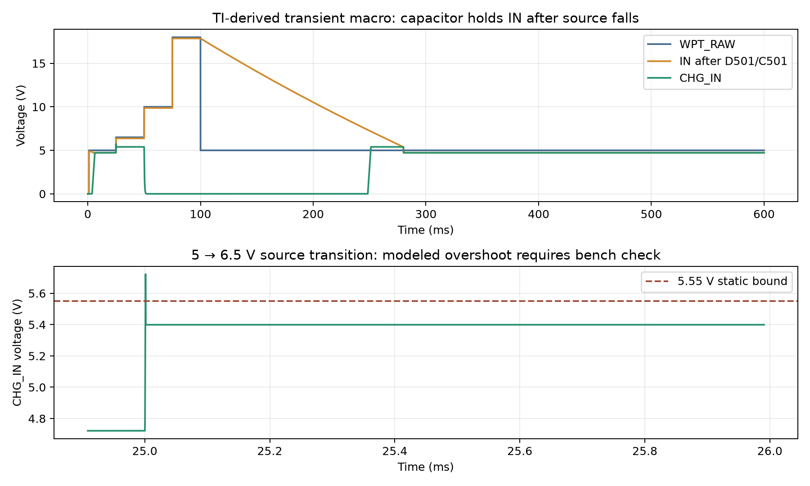
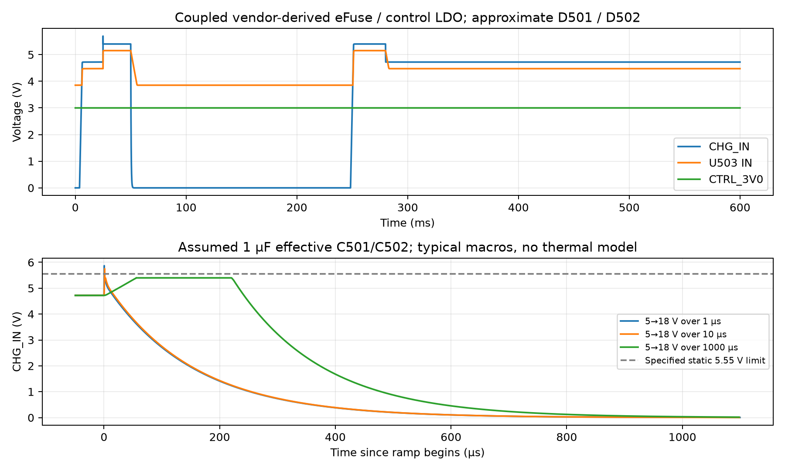
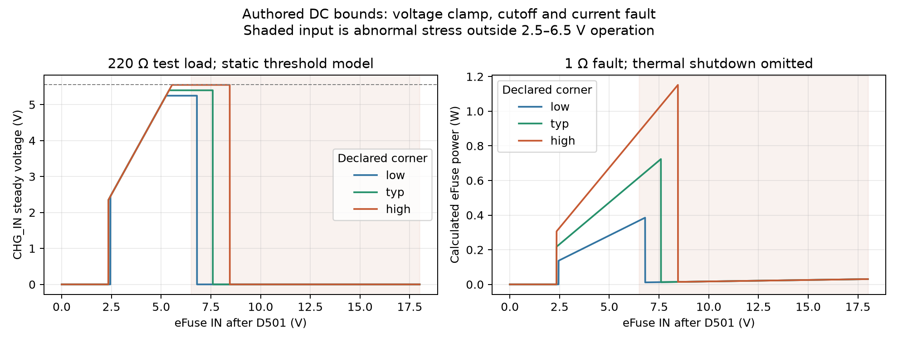
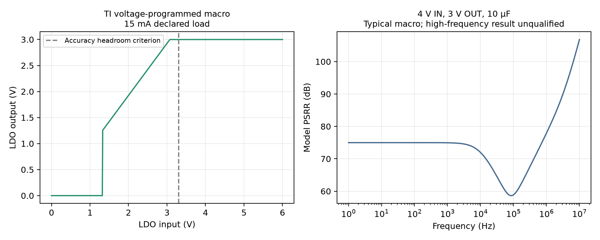
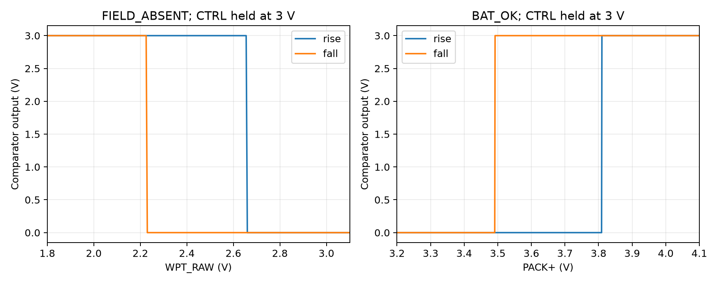

# CuraLink power LTspice verification

Recorded **2026-10-02, America/New_York**. Results are calculations and simulations, not hardware measurements. The current fixture value is **R511 = 1.00 MΩ ±1%**, matching stocked C26083. Earlier 1.1 MΩ runs are preserved under `historical-r511-1p1M/` and excluded from current results.

The modeled input eFuse correctly passes a normal 5 V source, clamps an elevated source and disconnects higher input faults in the tested cases. This supports the **bounded 4.75–5.25 V, current-limited bench input**. It does not release the raw RF receiver, a real lithium cell, arbitrary pack overvoltage or fabrication. The clamp's specified **5.55 V steady maximum is not a universal transient ceiling**: one minimum-capacitance fixture peaks at **5.868 V**.

## Models and scope

| Block | Model and provenance | Practical limitation |
|---|---|---|
| TPS25200 U502 | TI unencrypted PSpice transient macro from [SLVMA73](https://www.ti.com/lit/zip/slvma73), ported to LTspice by changing exactly two boolean XOR expressions | LTspice interprets the PSpice `^` expression as exponentiation. The documented `!=` replacement changes no electrical numbers. This remains a vendor-derived macro, not TI validation of the port or guaranteed silicon corner behavior. |
| TPS7A20 U503 / representative 3 V RUN regulator | TI voltage-programmed macro from [SBVM961](https://www.ti.com/lit/zip/sbvm961), programmed to 3.0 V | Generic model rather than exact TPS7A2030PDBVR silicon. TI states temperature and ground/quiescent current are not modeled. For coupled decks its generic comparator helper is renamed to avoid a symbol collision, with no numerical or electrical changes. |
| TLV3012B U504/U505 | TI macro from [SBOMCE5](https://www.ti.com/lit/zip/sbomce5) | Typical comparator behavior with CTRL held at an ideal 3 V. Its ideal reference and fixed CTRL fixture do not establish depleted-pack startup or all reference/supply corners. |
| BQ25185 and cell | No BQ25185 downloadable simulation model found in the official [TI model listings](https://www.ti.com/product/BQ25185) on this date | A 220 Ω load approximates about 21.5 mA at the simulated 4.72 V input. It does not model charger CC/CV, DPM, termination, timers, TS, battery impedance or chemistry. |
| D501 SS14 and D502 BAT54C | Explicit approximate diode equations in each deck | Forward drop, capacitance, reverse leakage, temperature and pulse behavior are not manufacturer-qualified. In particular, these models cannot qualify reverse-polarity recovery or the RF rectifier. |
| Static corner fixtures | Authored current-conserving DC model using published voltage thresholds and approximate current-limit curves | Represents DC threshold/clamp/current behavior only. Excludes thermal shutdown, overshoot, response delay, charge-pump state, reverse behavior, statistical correlation and startup. It is clearly separate from the TI macro. |

Original manufacturer ZIPs/PDFs, retrieval dates and SHA256 hashes are retained in [the source manifest](sources/source-manifest.json). Adaptation provenance is in [TPS25200 provenance](models/tps25200-provenance.json) and [TPS7A20 namespace provenance](models/tps7a20-namespace-provenance.json). The macros retain their manufacturer copyright notices.

## Actual runs and validity checks

LTspice **26.0.2** executed 19 current decks in hidden batch mode. The analysis checks every saved numerical value, excludes operating-point/log auxiliary raw files and identifies **18 finite analysis fixtures**. These are model-level datasets, not 18 hardware qualification passes. `vendor-efuse-dc.cir` is explicitly **rejected**: the transient eFuse macro has singular-matrix/charge-pump state problems in `.dc`, returns NaNs, and misleadingly reports nearly zero output despite an exit code of zero. Its raw/log are retained as diagnostic evidence; its numerical results are not used.

Current results and circuit/raw hashes are in [power-results.json](results/power-results.json). The rejected DC macro is replaced by independent fresh transient startup cases and the separately declared static model. This avoids interpreting stored capacitor charge or an invalid operating point as a hardware latch.

### Independent eFuse startup cases

Each `.step` run starts the input from zero, then rises over 10 µs and settles for 35 ms. Nominal C501/C502 are 2.2 µF, RLOAD is 220 Ω, and D501 is included. These values are **raw source voltage**, rather than the post-diode input used by the authored static sweep.

| RAW source | eFuse IN after D501, settled | CHG_IN, settled | Interpretation of nominal macro |
|---:|---:|---:|---|
| 5.0 V | 4.723 V | 4.722 V | Passes nominal source |
| 6.5 V | 6.374 V | 5.399 V | Output clamp active |
| 8.5 V | 8.373 V | ≈0 V | Nominal OVLO disconnect |
| 10 V | 9.872 V | ≈0 V | Nominal OVLO disconnect |
| 18 V | 17.867 V | ≈0 V | Nominal OVLO disconnect |

At RAW 8.5 V the macro's post-diode input is below the published **8.45 V maximum OVLO rising threshold**. Therefore this nominal-model result does **not** guarantee every silicon part has already disconnected at an 8.5 V RAW source. EN's maximum modeled voltage is 6.463 V; the 300 kΩ pull-up into the internal EN zener is explicitly supported by [TI §7.3.1](https://www.ti.com/lit/ds/symlink/tps25200.pdf).

The separate 1 Ω short fixture at RAW 5 V gives approximately **112 mA** input and **0.112 V** output. That result differs from the approximate 1 MΩ Eq. 1 nominal current of 96.3 mA, reinforcing that a macro is not a production current-limit guarantee. It also exceeds the small cell's required protection ceiling.

### Sequential fault and recovery

The nominal-capacitance sequence is RAW 5 → 6.5 → 10 → 18 → 5 V. The standalone eFuse fixture has a **5.722 V** modeled CHG_IN peak on its 5 → 6.5 V transition. RAW falls from 18 to 5 V at 100 ms, but D501 blocks C501 from returning its stored charge to the source: eFuse IN is still **15.547 V at 130 ms**. CHG_IN first rises above 3 V near **250 ms**, and returns to 4.722 V by the final settling window. This is modeled input-capacitor discharge and UVLO/OVLO recovery; it does not establish a latched-off device.



Adding the actual D502 diode-OR and U503 macro with PACK+ fixed at 4.1 V and an explicit 0.5 mA control load gives CHG_IN peak **5.695 V**, U503 **CTRL_INPUT peak 5.152 V**, and CTRL_3V0 peak **3.00032 V** in this same sequence. The connected capacitor changes the transient; compare voltage at the actual regulator pin rather than subtracting an assumed diode drop from an unrelated peak.

### Minimum-capacitance direct fault

The following coupled fixtures assume **1 µF effective C501 and C502**, 2.2 µF C506/C507, RAW initially 5 V, then a direct 5 → 18 V ramp. Minimum effective capacitance at fault bias is an assumption to be checked against the selected MLCC bias/tolerance data. Maximum transient timestep is 2 µs; LTspice internally refines around transitions. All outputs are finite.

| RAW ramp time | CHG_IN peak | Actual CTRL_INPUT peak | CTRL_3V0 peak |
|---:|---:|---:|---:|
| 1 µs | **5.868 V** | 4.650 V | 3.00030 V |
| 10 µs | 5.754 V | 4.672 V | 3.00031 V |
| 1 ms | 5.399 V | 5.137 V | 3.00031 V |

These specified cases stay below U503's 6.0 V recommended input maximum; they do not establish an all-slew bound. The [TPS25200 datasheet §8.2.2.2/Figure 8-3](https://www.ti.com/lit/ds/symlink/tps25200.pdf) explicitly describes OUT following IN during response. Its 0.6 µs response is reference-only typical data, not a guaranteed maximum. There is no defensible calculation of a universal overshoot ceiling from that typical number alone.



## Static OVP/current/power envelope

The authored `.dc` sweeps run **eFuse IN after D501** from 0 to 18 V, pair clamp 5.25/5.4/5.55 V with OVLO 6.8/7.6/8.45 V, and use 99 mΩ on resistance. Pairing extrema is illustrative, not a claim of correlated silicon corners. The clamp test in TI §5.5 specifies VIN 6.5 V, CLOAD 1 µF and RL 100 Ω; extrapolating it over the abnormal pre-OVLO region is a stated model assumption.

For R511 = 1 MΩ ±1%, TI Eq. 1's **approximate** minimum/nominal/maximum current curves give **56.93 / 96.31 / 138.38 mA**. The resistor's maximum is 1.01 MΩ, within the recommended 1.1 MΩ ceiling. The old 1.1 MΩ ±1% part could reach 1.111 MΩ and was replaced with the already-stocked C26083. Neither setting constitutes a guaranteed ≤50 mA cell protector.

With 220 Ω, the authored clamp plateaus are 5.248/5.398/5.548 V after the modeled on-resistance drop. With a 1 Ω fault and thermal shutdown deliberately omitted, maximum calculated eFuse power is **0.385 / 0.724 / 1.152 W**. The upper value occurs just below 8.45 V input. Applying TI's JEDEC θJA 66.5 °C/W would imply about **76.6 °C rise** at that static power; this is an illustration of why thermal behavior matters, not a prediction for the CuraLink PCB. The high-voltage off-state input-draw allowance is illustrative because TI's 1.7 mA maximum is specified at a 20 V test point, not every intermediate voltage.



U511's independent 820 kΩ ±1% RUN setting similarly gives Eq. 1 approximate **76.3 / 117.5 / 161.8 mA**. Neither eFuse covers harness shorts upstream of it. Optional BQ29737 protection is DNP and its threshold compatibility remains unresolved. A current-limited battery emulator is required until a qualified protected pack or revised PCM is released.

## LDO DC and frequency response

The generic TI model with a declared 15 mA load settles at **2.999 V** from 3.3 V and 4.0 V inputs. This verifies ordinary model regulation, while the actual part's accuracy condition remains VIN ≥ VOUT + 0.3 V. The [TPS7A20 datasheet](https://www.ti.com/lit/ds/symlink/tps7a20.pdf) gives 6.0 V recommended and 6.5 V absolute input limits. Near the lowest PACK+ cutoff corner of about 3.35 V, D502's forward drop can reduce U503 IN below the 3.3 V accuracy criterion. The control rail/reference must be checked during a slow pack discharge; holding CTRL at 3 V in the UVLO deck does not close that check. No newly qualified, stocked alternate control LDO has been substituted.

The AC fixture is 4 V input, 3 V output, 10 µF output and 15 mA load, with 1 V small-signal input stimulus. Model PSRR is approximately **75.0 dB at 1 kHz** and **58.9 dB at 100 kHz**. Its rising high-frequency curve is not accepted as a guaranteed device curve or rejection at 13.56 MHz. Compare the exact conditions with the manufacturer's typical curves and measure the assembled rail; layout/MLCC/parasitics are absent.



## Comparator checks

With CTRL fixed at 3 V, the vendor model changes FIELD_ABSENT near **2.658 V rising / 2.228 V falling** RAW input, and BAT_OK near **3.810 V restart / 3.492 V cutoff** PACK+. These are consistent with the intended hysteresis and the existing calculated corner ranges; the entire control/charge/run timing network has not been simulated here. The bipolar field-input sweep also finds about **−0.213 V** SENSE at −18 V RAW, within the −0.5 V absolute input limit but below the **−0.2 V recommended common-mode minimum**. Its logic state in that region is not a verified reverse-fault interlock.



## Exposed components and protection boundaries

The exact physical-pad and primary rating audit is linked at [the independent protection review](../protection-audit.md); this report adds model evidence rather than a second canonical design specification.

| Location / component | Relevant bound and present conclusion |
|---|---|
| Raw RF reservoir, coil, rectifier before D501 | U502 cannot clamp them. No RF voltage/temperature envelope has been qualified. Keep the WPT link DNP; matching or the published 70% coil-link result is not RF-to-DC validation. |
| D501 SS14 | [onsemi](https://www.onsemi.com/download/data-sheet/pdf/ss19-d.pdf) specifies 40 V reverse rating for SS14. It blocks reverse source voltage and holds C501 charge; it is not a voltage clamp. Manufacturer A1/K2 and cathode band orientation were repaired in the canonical record. |
| C501 / C502 | Canonical nominal 25 V capacitors tolerate the studied ≤18 V static voltage by rating, but the effective-capacitance assumption and surge/ringing remain checks. WPT_PROTECTED is upstream of the clamp despite its name. |
| U502 IN / EN / OUT | IN absolute 20 V; other terminals absolute 7 V. Nominal study peaks IN 17.867 V and EN 6.463 V. A bounded study below 20 V does not authorize unbounded input ringing. |
| RAW divider R516/R517, D509 and U505 | At +18 V, ideal divider SENSE =1.636 V, R516 power≈2.68 mW. At negative RAW, D509 limits current but its drop can violate recommended comparator common mode; do not rely on a defined logic state. [BAT54](https://www.diodes.com/datasheet/download/BAT54.pdf) reverse rating is 30 V. |
| BQ25185 IN | Absolute 25 V; internal OVP nominal 18.5 V cannot protect upstream RF parts. Rev B has an input-recommendation discrepancy: §5.4 lists ≤5.5 V but §5.5 lists 3.6–18 V. The simulated 5.868 V fault peak is below its absolute limit, but is not declared normal charge operation or a guarantee of correct charger behavior. Use normal 5 V. |
| D502 / C506 / U503 | [BAT54C](https://www.diodes.com/datasheet/download/BAT54.pdf) is 30 V reverse-rated; C506 is nominal 10 V; U503 is 6.0 V recommended/6.5 V absolute. Actual modeled IN peaks are reported above. PACK+ feeds U503 directly through D502 upstream of U511: arbitrary battery-emulator overvoltage is not covered by the RUN eFuse. |
| BQ BAT/control pins and pack branch | BQ non-IN pins absolute 5.5 V. Supply only correctly polarized 1S PACK+/emulator; PMOS/gate ratings and control inputs must be re-audited if arbitrary pack faults become a requirement. |
| AVDD/DVDD and FFC/debug | Input-side eFuse OVP does not protect against an LDO failed-high or externally driven 3 V rail. FFC/debug can back-power an OFF system. Main sequencing and AFE input-pin fault checks remain the separate canonical design/audit requirements. |

No additional hardware change is implied by these model results. The minimal corrections found and already integrated are TPS25200 physical-pad mapping, D501 A1/K2 and stocked R511 1 MΩ. New RF clamps, a different control regulator or battery protector require an explicitly qualified fault envelope and compatible sourced parts; the tests cannot justify guessing a replacement.

## Reproduce

From the project root in PowerShell, run the following. The scripts launch LTspice hidden and save runnable `.cir`, `.log`, ASCII `.raw`, CSV and PNG artifacts. The diagnostic eFuse `.dc` deck is expected to be rejected by the analyzer.

```powershell
$taskPython = 'C:/Users/angel/.cache/codex-runtimes/codex-primary-runtime/dependencies/python/python.exe'
& $taskPython hardware/rev-a/ltspice/power/adapt_vendor_models.py
& $taskPython hardware/rev-a/ltspice/power/build_power_fixtures.py
& $taskPython hardware/rev-a/ltspice/power/build_coupled_fixtures.py
& hardware/rev-a/ltspice/power/run-ltspice.ps1
& $taskPython hardware/rev-a/ltspice/power/analyze_power_results.py
```

Bench qualification should scope RAW, eFuse IN, CHG_IN and CTRL_INPUT together; vary input slew, effective capacitance and real charger/battery state; measure normal supply current and temperature. Stay within the bounded 5 V bench interface until those results close the RF and cell-protection gates. ESD/pulse survival, unpowered interfaces, lithium safety and complete CHARGE/RUN timing are not established by these sweeps.
