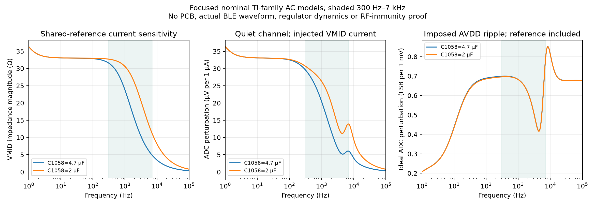

# Power, ground and reference integrity review

Recorded **2026-10-02, America/New_York** against the current Rev A canonical net records and engineering handbook v1.13. This review began before a routed CuraLink PCB existed. A new PCB's placement, planes, geometry, enclosure and extracted parasitics must be checked separately; the recommendations below are proposed routing rules, not physically verified results. No canonical circuitry or part choice is changed here.

## Priority findings

| Priority / evidence type | Finding | Consequence and proposed action |
|---|---|---|
| P1 — simulated circuit finding | U109B drives all channel reference returns through **R1149 47 Ω**, with feedback on VMID_BUF before the resistor. **C1058 4.7 µF** is shared. | The node has finite impedance and carries amplified filter-return current. The AFE agent's CH1-only run finds victim/self about −52.2 dB at300Hz and −55.5 dB at1kHz, below the proposed −60dB nominal criterion. Reopen VMID drive/distribution for review; qualify any lower isolation resistance or separate buffers for capacitive-load stability, power and recovery. |
| P1 — simulated circuit finding | A 100 mV CH1 offset step moves shared VMID about8mVpp and produces about8mVpp on an otherwise quiet channel in the existing nominal LTspice test. | Artifact invalidation must cover the shared AFE. Routing cannot eliminate this existing circuit path. Keep the candidate startup/recovery validity policy and verify it on hardware. |
| P1 — circuit fact / unverified physical risk | U512/U513 split AVDD/DVDD but share **PACK+, SYS_RAW and GND**. MCU **VDDA pin6** is AVDD and also the ADC reference. | BLE current changes can couple through input supply/ground; ADC reference charging can disturb AVDD directly. Separate placement and local return loops remain necessary. Split regulators alone do not establish rail/reference isolation. |
| P1 — circuit fact / unverified physical risk | CHARGE/RUN isolation turns off the conducted RUN path, but does not remove RF electric/magnetic fields, shared ground current or an externally driven FFC/debug connection. | Keep the raw coil/rectifier separate from inputs/REF/VMID. Disable the stimulus during OFF/CHARGE. Scope both rails for back-power and verify weak/intermittent field cases; do not equate low receiver DC with zero RF field. |
| P2 — calculated sensitivity | An imposed1mV AVDD sinusoidal ripple causes about0.68 ideal ADC LSB of baseline modulation at1kHz in the nominal full-AFE model, including changing ADC reference. | Use the actual AVDD voltage at MCU pin6 in the acquisition noise budget. A quiet-looking analog output alone is insufficient. About0.3mV peak in-band ripple is a candidate quarter-LSB allocation, not an accepted rail specification or measured result. |

## Exact supply and return paths

The RUN supply is `PACK+ → BAT_RUN → Q501/Q502 → SYS_PRE → U511 → SYS_RAW`. **R536/C525/U512** form the analog input/regulator branch; **R537/C527/U513** form the digital branch. U512 OUT pin5 is AVDD_3V0; U513 OUT pin5 is DVDD_3V0. **C524** is SYS_RAW bulk, **C526** the analog LDO output capacitor, and **C528** the digital output bulk. Route the two input branches from the supply distribution region, rather than through a shared thin digital trace before reaching the analog regulator. Keep their local input/output capacitor returns short to the same continuous ground plane. [TI TPS7A20 layout guidance](https://www.ti.com/lit/ds/symlink/tps7a20.pdf)

The input regulator suppresses conducted input ripple; it cannot correct a voltage difference between the ground locations of the fixture, AFE and ADC. For an **assumed**, unmeasured20mA incremental digital current, a shared10mΩ return produces200µV and100mΩ produces2mV. If that appears differentially between CH and REF, it is an input error before the gain. If it appears identically on both, actual source/loading/matching determines rejection. These assumed resistances are not PCB extractions.

Use continuous ground with component zoning and short local current loops. Do not place a narrow analog/digital ground bridge under the ADC routes or force digital return current through the REF/VMID region. This is a proposed application of established mixed-signal return-path practice; RF antenna clearance and very small high-impedance capacitance-clearance pockets must be handled without interrupting unrelated signal return corridors. [Analog Devices AN-1142](https://www.analog.com/en/resources/app-notes/an-1142.html)

## VMID is an active shared reference, not ground

**R540/R541 =10kΩ/10kΩ and C529 =2.2µF** generate VMID_RAW from AVDD. Their Thevenin resistance is5kΩ and calculated pole is14.47Hz. U109B uses physical pin4=VMID_RAW, pin5=VMID_BUF feedback, pin6=VMID_BUF output, pin3=AVDD and pin10=GND. R1149 feeds VMID, and C1058 returns VMID to GND. Its simple isolated47Ω/4.7µF pole is720Hz; at the assumed minimum2µF it is1.69kHz. The actual multichannel load changes the impedance, so these isolated RC numbers are not the system response.

VMID receives nine preamp bias/gain returns, eight differential-stage balance returns, and the two Sallen-Key sections' gain/capacitor returns per channel. For example, CH1 **R1003**, **R1010**, **R1013**, **R1017**, **C1005** and **C1007** touch VMID; the corresponding channel elements repeat this shared connection. Late-stage output currents therefore share a reference with early-stage bias/REF. U109A's REF_PRE then fans out to all eight high-pass branches, providing a second common path.

Put U109, R1149 and C1058 together, with a tight buffer loop and short C1058 ground return. Route VMID_RAW as a short quiet sense net and keep it away from REF_PRE, AFE outputs, clocks and the raw receiver. Distribute VMID with a low-impedance backbone and short branch returns; avoid a daisy chain that carries later-channel filter current past the first preamp. Keep the exact feedback before R1149 unless a different loop is explicitly designed and stability-qualified. Adding a large capacitor after a buffer, or moving feedback after the resistor, is not automatically stable. [TLV900x layout and capacitive-load guidance](https://www.ti.com/lit/ds/symlink/tlv9004.pdf)

Meaningful redesign candidates are stronger/lower-impedance shared drive, or separate quiet input bias from filter signal returns. Each costs different power, area, matching and startup complexity. A lower R1149 can improve nominal impedance but exposes the buffer to a larger capacitive load; a split-reference implementation can also create differential errors unless its references track. These remain candidates for focused comparison, not approved part or topology changes.

## Focused actual LTspice sensitivities

Two new decks reuse the original-equation, namespaced TI amplifier family models and the current36-amplifier canonical circuit. Only C1058 is parameterized for nominal4.7µF / assumed minimum2µF. All sources remain grounded through their47kΩ source branches. The tests are normalized small-signal AC: **AVDD ripple injection** and **current injection into shared VMID**. They do not simulate actual BLE current, regulator dynamics, PCB geometry, RF rectification, amplifier mismatch or MCU conversions. Both runs completed with finite data and a valid ADC DC baseline near1.503V.

The analyzer reads actual `.step` values from the log because LTspice sorted the descending capacitor list numerically. It interpolates complex traces in log frequency at300Hz/7kHz;1kHz is an exact grid point. Decks/logs/raw/CSV/provenance are retained in [power](power/), with machine-readable [results](power/results.json).

| C1058 case | Frequency | VMID impedance | Quiet ADC perturbation per1µA injected into VMID | Ideal ADC perturbation per1mV AVDD ripple |
|---|---:|---:|---:|---:|
| 4.7µF | 300Hz |31.7Ω |29.8µV |0.699LSB |
| 4.7µF | 1kHz |23.8Ω |20.5µV |0.682LSB |
| 4.7µF | 7kHz |4.88Ω |6.04µV |0.777LSB |
| 2µF assumed minimum | 300Hz |32.7Ω |30.8µV |0.696LSB |
| 2µF assumed minimum | 1kHz |30.6Ω |26.3µV |0.682LSB |
| 2µF assumed minimum | 7kHz |11.2Ω |13.9µV |0.777LSB |

The ADC column includes first-order reference dependence:

`δcode = (4096/3) × [δVADC − (VADC,DC/3)×δAVDD]`.

At1kHz the nominal analog output alone changes44.6µV per1mV AVDD ripple; the ADC-reference term makes the code disturbance much larger. This is a deterministic sine sensitivity in an ideal12-bit calculation; it is not RMS noise, ENOB or an observed ADC result. Likewise1µA current injection is a sensitivity unit, not an asserted real reference current. The existing [CH1 artifact](../ltspice/afe/AFE-LTspice-review.md) and the AFE agent's channel-aggressor test establish the circuit connection between actual channel activity and this shared node.

## Bulk versus local bypass

Keep **C401–C404** at MCU VDD pins11/22/35/43, **C410/C411** at VDDRF39/VDDRFPA42, and **C406/C407** at VDDA6. VCAP44 uses **C4084.7µF**, and internal VDDHPA38 uses **C409470nF**; neither is an externally supplied rail. Their capacitor loops and exposed-ground-pad connection must follow ST's reference layout. Place **C40510µF** by the MCU supply entry while keeping **C52810µF** by U513. [ST DS14127](https://www.st.com/resource/en/datasheet/stm32wba52cg.pdf), [ST MB1863 reference schematic](https://www.st.com/resource/en/schematic_pack/mb1863-wba52cga-a03-schematic.pdf)

AFE **C1059–C1067** are local 100 nF bypasses for U101–U109; the additional AFE bulk **C1068 = 4.7 µF** must remain close to its analog distribution region. U109's supply/ground loop matters especially because REF and VMID share its package. A remote 4.7 µF/10 µF capacitor does not replace local 100 nF loops. Keep filter resistor/capacitor and feedback connections short; sensitive inverting-node capacitance can change gain/phase and stability. [TLV900x layout](https://www.ti.com/lit/ds/symlink/tlv9004.pdf), [TLV905x layout](https://www.ti.com/lit/ds/symlink/tlv9054.pdf)

An illustrative capacitor-only estimate gives `ΔV=IΔt/C`: assumed20mA for10µs removes20mV from10µF, or100mV from2µF. Actual LDO replenishment, capacitor bias loss, ESR/ESL and placement change the result. Count **effective** capacitance, keep the established ≤100µF total AVDD energy allowance and recalculate discharge timing if bulk is increased; indiscriminate extra capacitance can undermine CHARGE/RUN transition timing.

## Charging, control thresholds and OFF behavior

The high-frequency RX/tuning/rectifier loop belongs near its own reservoir/return, away from J301 and U109. BQ25185 is a linear charger and WBA52 has no SMPS; there is no justification for inventing a switching-regulator aggressor. Actual aggressors are RF coil/rectifier currents, digital/RF activity, diode/enable edges and rail charging/discharging. Keep **D501/C501/U502/C502/U501** and the charger-local **C503/C504** loops compact, with a return path to the power-entry region that avoids input/REF ground corridors. The previous [OVP results](../ltspice/power/README.md) establish only their declared modeled conditions.

U505 senses receiver **DC** through R516/R517 and C514. Nominal field detect/release is about2.66/2.23V in the fixed-control-rail model. A weak RF field can exist while receiver DC is below that threshold and RUN is allowed. The operating policy must therefore be tested under weak/misaligned/intermittent fields rather than inferred solely from an on/off input voltage.

Keep **BAT_SENSE** R513/R514/R515/C513 near U504, **WPT_SENSE** R516/R517/C514 near U505, and **DIGITAL_SENSE** R549/R550/R551/C531 near U515. Keep their ground ends and **C512REF bypass** close to the comparator/reference ground region; do not return them through Q507/Q508 discharge pulses. R513 is1MΩ, so10nA of unmodeled leakage into that divider changes the pack-referred threshold by roughly10mV. Keep flux/contamination and fast nets away. Route **RUN_DELAY/C518** and **CHARGE_DELAY/C519** as quiet timing nodes; a long high-impedance delay trace can couple an edge into the interlock. [TLV3012B input/POR/reference requirements](https://www.ti.com/lit/ds/symlink/tlv3012.pdf)

Q507/Q508 and their100Ω discharge paths must return locally without sharing a thin REF/ADC ground trace. They remove stored charge, not injected current from a powered fixture/debugger. FFC AC coupling still transmits a changing waveform when AVDD is off, and amplifier rail clamps can back-power AVDD. J401/J402/J403 must use target-referenced non-powering debug/serial tools. Multiple PC/instrument ground connections can form an external shared-return loop; test the exact cable/debug setup rather than assuming every ground label is equipotential. The [independent protection audit](../ltspice/protection-audit.md) documents the existing limits and separate pack/receiver gates.

## Proposed physical acceptance checks

Review the generated PCB against these constraints before routing release: uninterrupted signal-return corridors; short regulator/bypass loops; no BLE/clock/output parallel run beside input/REF/VMID; VMID distribution and R1149/C1058 placement; short matched source/REF paths; quiet comparator/timing nodes; and receiver/charger/discharge loop separation. Verify with final cables and battery/coil enclosure.

For bring-up, capture AVDD at VDDA6, DVDD at the RF/VDD region, VMID atTP126 and quiet ADC output simultaneously during worst planned BLE traffic. Drive one channel while the other seven and REF remain quiet; compare ratios across300Hz–7kHz and artifact recovery separately. Repeat powered-OFF stimulus/debug checks, weak WPT and mode transitions. A successful BLE link, a clean static output, or passing ERC does not quantify channel crosstalk or physical coupling.
