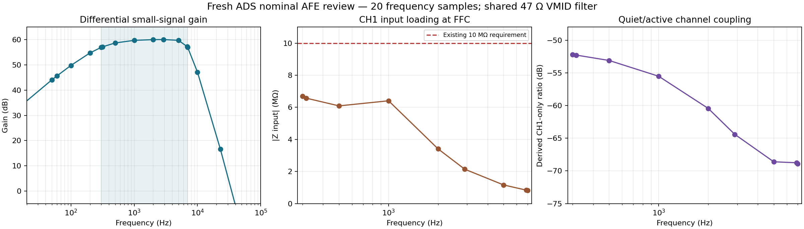

# Actual ADS AFE bias and AC review

**2026-11-22, America/New_York. Actual ADS 2026 Update 2 runs of the existing eight-channel circuit. Nominal simulation evidence; no hardware or fabrication signoff.**

The neural AFE was not present in the saved WPT ADS workspace. This review translated the existing [canonical AFE and original TI family models](../../../../rev-a/ltspice/afe/AFE-LTspice-review.md) into a standalone ADS deck. It does not substitute ideal op-amps or change the schematic. The separate WPT study retains the paper's fixed coils.

## What was transferred

`nettrans.exe -lt -g` translated the original-equation TI TLV9002/TLV9052 family macros used for the TLV9004/TLV9054 units. All 35 model/helper subcircuits were retained. [The source manifest](translation-source-manifest.json) records the original include-file hashes; flattened originals, native translations and separate translator detail logs remain in this folder.

[An independent translation audit](translation-topology-check.json) verifies the nodes and values of **272 passives** (236 circuit components plus 36 declared stimulus/cable components) and all **36 amplifier five-pin mappings**. There are zero mismatches. The fixture retains a 3 V ideal analog rail, 47 kΩ source branches, assumed 20 pF FFC / 2 pF trace / 0.5 pF ESD capacitance, nominal passives, shared reference and the existing 47 Ω VMID filter. No PCB copper/extracted coupling, switched ADC core, rail sequencing or unpowered-input protection is included.

Translation drops `.save`, analysis commands and LTspice output-format options, so the deck explicitly supplies native ADS DC/AC controllers and output plans. ADS also ignores the noiseless-resistor model's `T_ABS=-273.15`; **noise analysis is disabled and no new noise result is claimed**. Other model equations remain the translated originals.

## Fresh numerical results

The successful deck is [afe-dc-ac.ckt](afe-dc-ac.ckt). [The simulator log](run/simulator.log), [dataset](run/afe.ds), CSV exports and [results.json](results.json) preserve the actual run. It contains a DC solution and two normalized AC source cases at 20 explicitly verified frequencies from 0.01 Hz to 1 MHz, including 300 Hz, 1 kHz, 6.88 kHz and 7 kHz. This is a targeted sample set, not a dense new corner search.

| Check | Fresh ADS result | Interpretation |
|---|---:|---|
| Amplifier equilibrium | All 36 pass the declared nominal checks | Finite input common modes inside 0–3 V, outputs inside 0.2–2.8 V and input differences below 1 mV; not guaranteed silicon/PVT limits. |
| VMID | 1.500482797 V | Biased near half rail. |
| ADC equilibrium | 1.503194882 V on all eight channels | About 165 µV below the rounded prior LTspice baseline; remains near half rail. |
| Analog-rail current | 4.471805 mA | Finite current from the top-level VDD source; excludes MCU/control and radio loads. |
| Differential gain at 1 kHz | 969.742440 V/V | Within 0.000161% of the rounded prior LTspice 969.744 V/V result. |
| Gain at 300 Hz / 7 kHz | 702.63 / 704.86 V/V | Nominal useful-band rolloff is reproduced. |
| Nominal CMRR at 1 kHz | 70.017 dB | Matched macro/passive fixture only; not mismatch or assembled CMRR. |
| Worst sampled CH1-only coupling, 300 Hz–7 kHz | −52.218 dB at 300 Hz | Reproduces the known shared-VMID problem; −55.523 dB at 1 kHz. |
| CH1 input impedance at the FFC, 7 kHz | 24.17 kΩ − j822.18 kΩ; magnitude **0.82254 MΩ** | Fails the existing ≥10 MΩ requirement. |



DC bias/feedback and the nominal frequency response therefore behave as intended in this model. The input-impedance requirement and shared-bias coupling remain explicit gates to clean-signal/build acceptance.

## Source vectors, impedance and coupling

The differential case drives CH1 by +0.5 V and all other channel/reference sources by −0.5 V; the common-mode case drives all sources by +1 V. These are normalized small-signal phasors, not physical one-volt neural inputs. The actual saved source-node vectors are checked in [analyze_afe.py](analyze_afe.py).

Linear superposition `S = differential + 0.5 × common` produces CH1 = 1 and every other channel/reference source = 0. It yields the derived quiet/active ADC ratio and the driving-point input impedance without another nonlinear operating point or a claim of a separate driven dataset. The FFC boundary is after the 47 kΩ source resistor:

```text
Z_FFC_CH1 = V(FFC_CH1)_S / [-I(VCH1)_S]
coupling = max(|ADC2…ADC8|_S) / |ADC1|_S
```

Both results use actual saved complex spectra. They are not PCB parasitic extraction. At −52.218 dB, a 200 µVpp / 1 mVpp single aggressor corresponds to about 0.49 µVpp / 2.45 µVpp input-equivalent quiet-channel coupling in the linear fixture. Multiple aggressors, artifacts and physical coupling remain separate questions.

## DC topology corrections and model-port limits

ADS reports 252 automatic no-DC-path corrections. A verbose follow-up identifies **seven nodes inside each of the 36 TI amplifier macros and no top-level CuraLink node**; see [the full list](topology-corrections.json). The nodes belong to internal offset/common-mode and related controlled-source structures, such as `xu101_1._node33`, `_node22`, `_node21`, `xvos_vcm._node1`, `_node81`, `_node85` and `_node86`, with corresponding names in the other family.

Installed primary ADS documentation, *Troubleshooting a DC Simulation*, says the topology checker inserts a default 10¹² Ω path to ground, controlled by GMIN. *Options* documents verbose node reporting through `TopologyCheckMessages`. These are simulator/model return references, not resistors added to the physical PCB. The independent external-circuit return-path audit remains relevant; numerical correction of an internal macro does not validate PCB return routing.

The first GMIN parameter-loop experiment returned identical outputs, but topology correction occurs before that loop; it is **not sufficient evidence** that the automatic resistors were reconstructed at each setting. A separate fresh initialization with literal `Gmin=1e-13 S` was terminated at its **180 s time limit without a completed DC point**. Its partial dataset is not passing evidence; [execution status](gmin-lower-initialized-run/execution.json) records the incomplete check. GMIN sensitivity and complete macromodel-port qualification therefore remain open. Similar nominal gain and bias are useful cross-simulator checks, not full macromodel qualification.

The first AC attempt used unsupported inline Start/Stop/Dec controller fields and ran only 1 mHz. That frequency-response attempt is **rejected**, preserved under [diagnostic-invalid-ac](diagnostic-invalid-ac/qualification.json), and excluded from all tables/plots here. An initial syntax error in the GMIN diagnostic is also retained as rejected evidence. Successful process exit alone was not treated as a pass.

## Continue before building

Resolve the input-loading requirement or explicitly reopen it; a buffer after the FFC cannot remove capacitance already loading the source. The existing preamps already provide active voltage drive isolation. Qualify shared-VMID coupling/recovery, startup blanking, actual ADC operation and off-state injection. Existing saturated offset/startup behavior and unfinished physical PCB returns are not closed by this DC/AC study.

For reruns, use ADS's bundled Python and an available ordinary simulator seat:

```powershell
python run_afe.py
python analyze_afe.py
python plot_afe.py
```

Run them from this folder or pass their full paths. They affect only this review's outputs. Read the logs, source/model limits and existing [engineering record](../../../../../docs/engineering-handbook.md) before treating any result as a design acceptance.
