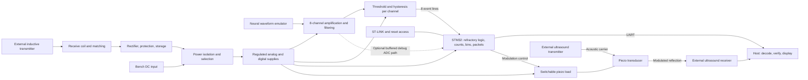

# CuraLink — initial architecture and planning notes

Date: 2026-09-18. Read alongside the [requirements](CuraLink-requirements-v0.1.md). Fixed architecture comes from the user brief. Numerical examples below are engineering planning assumptions, not literature-derived biological specifications, component estimates, or measured results.

## System architecture



The diagram fixes the functional boundaries; it does not select circuit topologies, rail voltages, carriers, or transducers. Prevent bench power from backfeeding the rectifier. A debug ADC connection must not load the AFE or inject sampling disturbance unchecked.

## First power allocation

Use the following as a feasibility worksheet. It gives component selection a starting envelope; every entry must be replaced by datasheet-based operating-mode calculations and then measurements.

| Function | Proposed average allocation | Basis |
|---|---:|---|
| Eight analog front ends | 10.0 mW | 1.25 mW/channel allocation |
| Eight detectors | 1.0 mW | 0.125 mW/channel allocation |
| References and threshold generation | 1.5 mW | Shared allocation |
| STM32 including event handling and packet production | 8.0 mW | Average activity assumption; peak remains open |
| Board-side telemetry switch/control | 0.5 mW | Excludes external ultrasound equipment |
| Other board loads | 1.0 mW | Pull-ups, monitors, and other enabled loads |
| Subtotal at regulated rails | **22.0 mW** | Sum of functional allocations |
| 30% design reserve | **6.6 mW** | Explicit engineering margin |
| Rail delivery target for this example | **28.6 mW** | Subtotal plus reserve |

If aggregate regulation efficiency were 80%, required rectified DC would be:

`P_rectified = P_rails / eta_reg = 28.6 mW / 0.80 = 35.75 mW`.

This excludes any upstream loss omitted from the chosen regulation boundary. Include regulator quiescent power in the final accounting. For LDOs, calculate input current and voltage drop directly. Startup, event bursts, telemetry switching, and storage recharge need separate peak/transient budgets.

External power cannot yet be specified. Define end-to-end efficiency at explicit measurement planes:

`eta_WPT = P_system_DC / P_external_TX_input`.

Do not infer available DC power from coupling or S21 alone. Freeze frequency, geometry, separation, and load before using an EM/circuit model to claim feasibility.

## Signal and noise budget framework

First establish waveform peak amplitude, source impedance, electrode-like offset, bandwidth, and interference conditions. Do not use an arbitrary gain as a substitute for those requirements.

For an illustrative design point only, suppose input peaks are 50–500 microvolts and total gain is 500 V/V. Output peaks would be 25–250 mV. A provisional 5 microvolt RMS input-referred noise allocation would produce 2.5 mV RMS output noise. These values are examples for sizing and must be checked against literature and the intended emulator before adoption.

At a hypothetical 3.3 V rail with a 1.65 V signal bias, verify actual amplifier/comparator common-mode range and output swing. Artifact recovery and DC offsets may set the headroom requirement even when small spikes fit comfortably.

Use input-referred contributions at a common reference plane:

`e_total_rms = sqrt(e_source^2 + e_amplifier^2 + e_resistors^2 + e_reference^2 + e_other^2)`

This root-sum-square expression assumes uncorrelated contributions; treat correlated interference separately. Include noise bandwidth and each stage's transfer function. Comparator offset, threshold accuracy, hysteresis, and switching interference need separate detection-error accounting. Detection probability cannot be claimed from a peak-to-RMS ratio alone.

## Event, bin, and telemetry proposal

Start firmware evaluation with a **20 ms bin**, configurable later. Use eight 16-bit counts with saturation reporting; never silently wrap counters. Define bins as half-open time intervals `[start, end)`. Events exactly at the boundary belong to the next bin. Specify whether the timestamp represents hardware capture or interrupt service time and measure boundary uncertainty.

Proposed fixed packet: 2-byte sync, 1-byte version, 1-byte flags, 2-byte sequence, 4-byte bin-start timestamp, 2-byte bin duration, 16-byte count vector, and 2-byte CRC: **30 bytes**. Byte order, timestamp units/wrap handling, CRC variant/coverage, parser recovery, and sequence rollover still need a protocol specification.

At 20 ms bins: `50 packets/s × 30 bytes × 8 = 12,000 bit/s` before physical-layer overhead. UART 8N1 requires `50 × 30 × 10 = 15,000 bit/s`. A proposed Manchester-coded ultrasound mode would require 24,000 line symbols/s before additional preambles, gaps, or retries. Backscatter bandwidth remains unproven; bin duration, coding, and packet overhead must be reconsidered against measured link capacity.

Use an atomic bin handoff/double buffer so transmission never blocks acquisition. Define overflow/backpressure behavior and report dropped bins. Stress simultaneous channels and bursts, not only average event rates.

## Interfaces and MCU resource needs

| Interface | Initial contract | Open item |
|---|---|---|
| Emulator to AFE | Eight analog inputs and a defined reference | Source impedance, offsets, amplitude, polarity |
| AFE to detector | Band-limited waveform around a defined bias | Gain, headroom, threshold and hysteresis ranges |
| Detector to MCU | Eight independent event inputs | Logic levels, pulse width, output type, edge semantics |
| MCU to telemetry | Buffered digital modulation control | Timing, coding, switch drive, piezo voltage limits |
| MCU to threshold circuit | Configurable control if practical | Per-channel/shared settings, DAC and bus choice |
| MCU to host | UART commands, diagnostics, and count packets | Baud, framing, binary/log separation |
| Debugger to MCU | SWD, reset, ground, voltage reference | Connector/pads and selected part's boot configuration |
| Power to loads | Isolatable analog/digital rails | Voltages, ripple limits, sequencing, current peaks |

Reserve at least eight event GPIOs, two UART pins, two SWD pins, one modulation pin, and reset access before assigning optional analog controls, clock pins, power enables, and ADC functions. This is a functional count, not a package pin count. Verify alternate-function conflicts and the exact device's interrupt routing before committing to a package. Evaluate a free-running timebase, bin timer, transmission peripheral/timer with DMA if useful, and buffer memory. Do not assume every desired input can be independently captured by hardware on every STM32.

## Initial risks and exit evidence

| Priority | Risk | Evidence needed before integration/fabrication |
|---|---|---|
| High | Ultrasound reflection change is too weak or obscured by direct TX leakage | Independent known-pattern link test with repeatable error and alignment measurements |
| High | Wireless power cannot sustain operation/startup | EM-derived coil model plus nonlinear rectifier simulation and load/startup tests |
| High | AFE noise, offsets, artifacts, or threshold drift cause errors | One-channel simulation and bench characterization using realistic source/noise conditions |
| High | Coil, piezo, eight AFEs, MCU, and test access exceed the footprint | Early package/area/mechanical study with assembly clearances |
| High | First-board fault prevents debugging | Reviewed isolation, bypass, injection, tuning, programming, and probe access |
| Medium | Simultaneous events or bin rollover corrupt counts | Deterministic event-injection tests, boundary tests, and measured timing limits |
| Medium | WPT/digital activity contaminates the AFE | Compare noise and detection results with each aggressor enabled and disabled |

## Simulation and development sequence

1. Confirm budget, equipment, timeline, and measurable input/link requirements. Replace numerical examples with sourced targets.
2. Simulate one AFE/detector channel: AC response, integrated noise, transient spikes/noise/artifacts, tolerances, clipping/recovery, and supply disturbance.
3. Select MCU resources and prototype known-event counting, UART, packet decoding, and automated tests on available development hardware.
4. Develop WPT geometry in Momentum/HFSS as available; import network data into ADS for matching, rectification, startup, and load analysis. Preserve model versions and measurement planes.
5. Bench-test the ultrasound load modulation independently with a known bit pattern and a defined medium, distance, and alignment.
6. Review interfaces and component/package choices, then integrate the schematic. Require pin/footprint, boot/debug, power, ERC/DRC, assembly, and BOM reviews before fabrication.

## Next deliverables and project organization

### One-month schedule constraint

User-confirmed on 2026-09-18: completion needed within one month; extensive lab equipment and ST-LINK available; borrowing an STM32 development board is being investigated. Plan toward 2026-10-18 unless a different exact date is supplied. Budget and simulation-software access remain open.

This is an aggressive schedule for both wireless links plus a first PCB. The schedule below is conditional on hardware availability and measured feasibility; it is not a promise of full completion.

| Window | Work and exit condition |
|---|---|
| Days 1–3 | Confirm instruments, software, MCU board, piezos, budget, and actual PCB/parts lead times. Define input and link targets. Establish the latest safe fabrication release date. |
| Days 4–7 | Simulate/bench-test one analog channel; validate event counting and UART on the development board; test ultrasound modulation; begin coil/rectifier analysis. |
| Days 8–12 | Review feasibility evidence, freeze interfaces and components, integrate/review schematic and layout. Release only after the fabrication checklist passes and confirmed lead times permit bring-up. |
| Days 13–22 | Conditional fabrication/delivery window; finish firmware, receiver, emulator, host tests, and bring-up procedures. Continue wireless bench tests. |
| Days 23–30 | Assemble and bring up with bench power, verify eight channels, then integrate telemetry and wireless power; capture measurements and document limitations. |

Calculate latest release from the deadline minus the supplier's confirmed fabrication/shipping interval and reserved assembly/debug time. If those dates do not fit, flag the conflict immediately. A wired/bench-powered demonstration is a useful interim result, but does not satisfy the full wireless objective. Any scope reduction must be explicit.

This kickoff supplies the requirements draft, functional diagram, preliminary budget calculations, interface/resource needs, initial risks, and simulation sequence. **The major-IC shortlist and final pin map are still pending** signal targets, budget/equipment details, and manufacturer-datasheet checks. No purchasing recommendation is made yet.

Evaluate amplifiers, comparators, STM32, references/threshold generation, regulators, rectifier parts, piezo, and load switch against electrical fit, stock, assembly, debug access, power, and area. Record exact orderable packages and alternatives; a family name is not an approved BOM entry.

Proposed repository layout for implementation:

```text
firmware/       app, drivers, event, telemetry, power, diagnostics, tests
tools/          build/flash, UART control, packet decode, capture, automated tests
simulation/     afe, power, wpt, ultrasound
hardware/       schematic, pcb, bom, fabrication
docs/           requirements, interfaces, measurements, bringup, design_reviews
```

Immediate working target: define a reproducible one-channel analog test alongside an eight-channel digital-event test, with all expected inputs and outputs recorded before implementation.
